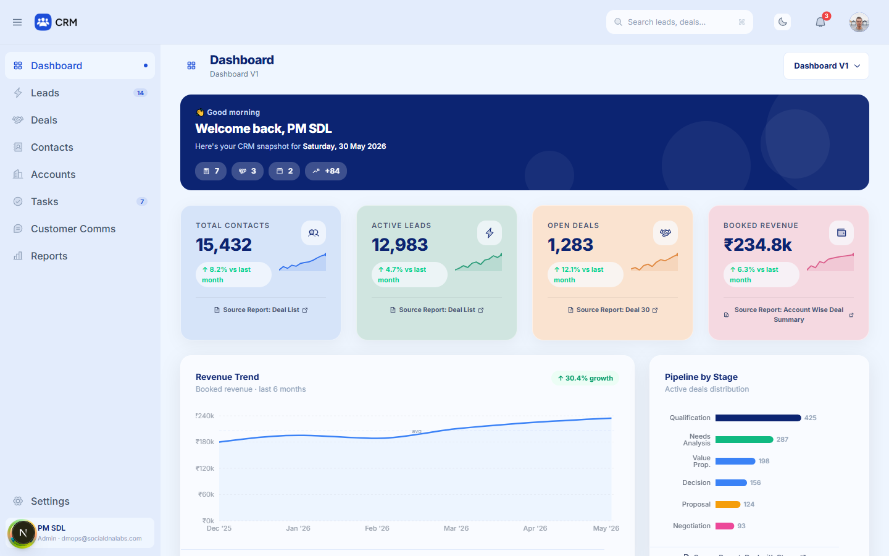
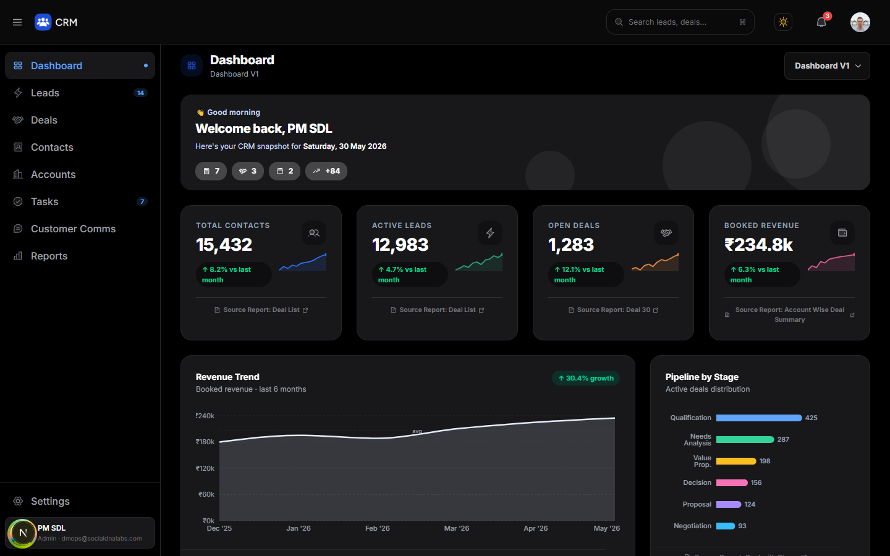
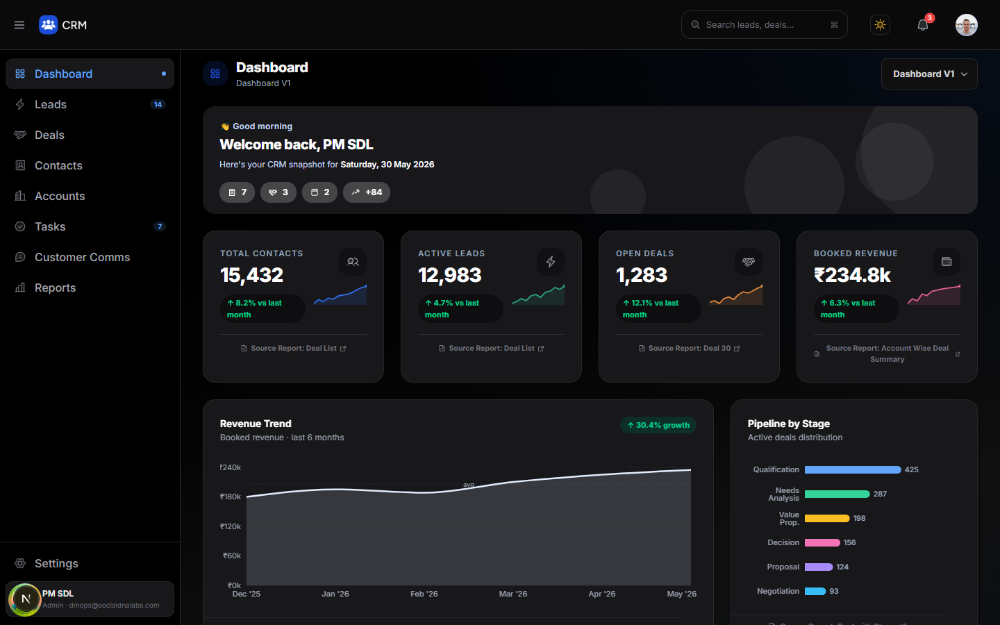
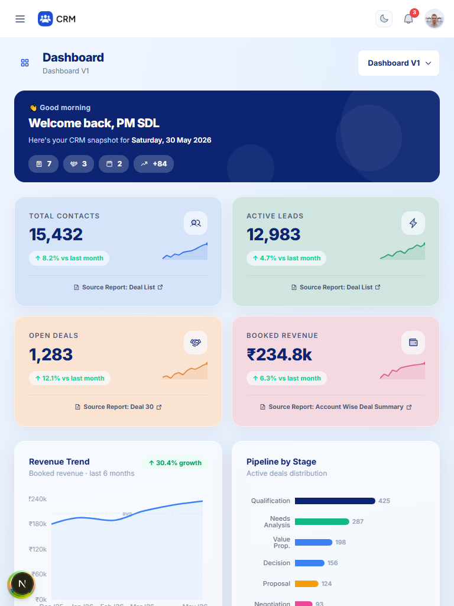
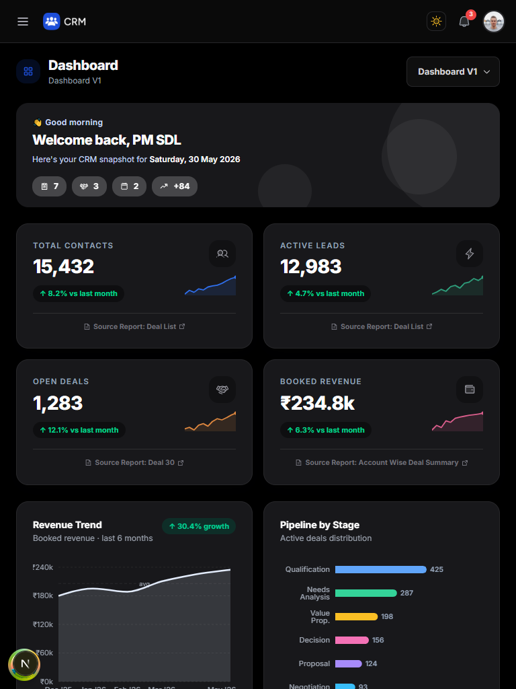
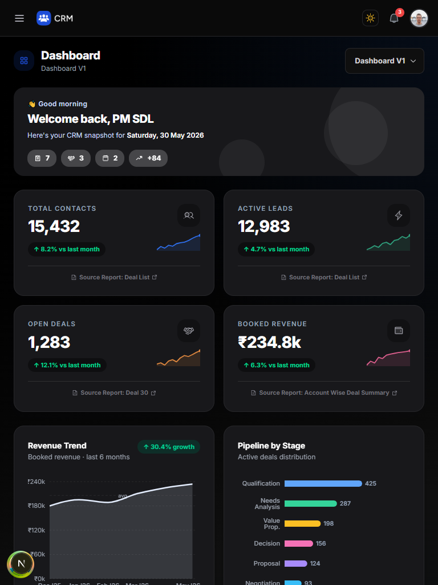
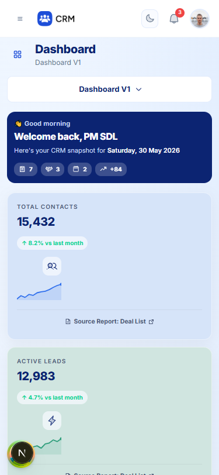
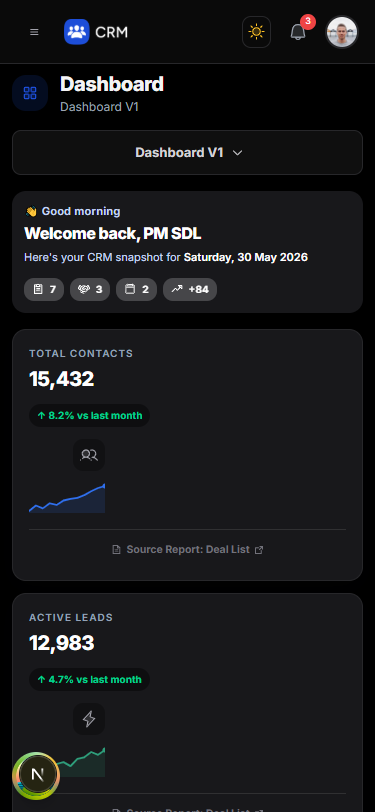
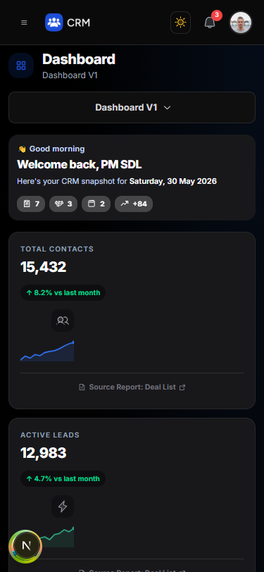

# Step 3 — Dashboard right-side canvas gradient

Local-only. No Git, deploy or dependency changes.

## What changed

The Dashboard's right-hand canvas (`div.sidebar-content`, everything right of the sidebar and
below the header) previously had **no background of its own** — the flat page colour came from
`body { background-color: var(--bg-page) }` (`#EFF6FF` light, `#000000` dark). It now has a subtle
brand gradient built from existing design tokens.

### Files modified (2)

| File | Change |
|---|---|
| `app/globals.css` | 4 new tokens per theme (`--canvas-from/-via/-to/-glow`) next to the existing `--bg-*` tokens, and one new class `.dashboard-canvas` (background only) |
| `app/page.tsx` | Added the `dashboard-canvas` class to the existing wrapper `div` (one attribute; no markup/layout change) |

Nothing else in Step 3 was touched. (Build/typecheck tools also rewrote the tracked
generated files `tsconfig.tsbuildinfo` and `next-env.d.ts`; they are tool output, not edits.)

### Gradient and tokens

```css
.dashboard-canvas {
  background-color: var(--canvas-from);
  background-image:
    radial-gradient(120% 70% at 100% 0%, var(--canvas-glow) 0%, transparent 60%),  /* soft top-right glow */
    linear-gradient(165deg, var(--canvas-from) 0%, var(--canvas-via) 55%, var(--canvas-to) 100%);
  background-repeat: no-repeat;
}
```

| Token | Light (`:root`) | Dark (`html.dark`) |
|---|---|---|
| `--canvas-from` | `var(--bg-page)` → `#EFF6FF` | `var(--bg-page)` → `#000000` |
| `--canvas-via` | `color-mix(var(--border) 65%, var(--bg-page))` → ≈ `#E7F0FD` | `var(--bg-surface-2)` → `#0F0F0F` |
| `--canvas-to` | `color-mix(brand-100 40%, var(--bg-page))` → ≈ `#E7F1FF` | `color-mix(brand-900 22%, var(--bg-page))` → ≈ `#070D16` |
| `--canvas-glow` | `brand-500` at 6 % alpha (`#3B82F6`) | `brand-500` at 10 % alpha |

Only existing tokens/brand colours are used (`--bg-page`, `--border`, `--bg-surface-2`,
`brand-100/500/900`); the hex fallbacks inside `var(--color-brand-*, …)` match the existing
`@theme` values. No new palette, no new dependencies. The theme switch is automatic because the
tokens are redefined under `html.dark`, which is already server-rendered from the theme cookie
(Step 2), so there is no flash and persistence is unchanged.

The first draft used a deeper light-mode end stop; contrast measurement showed it lowered
muted-text contrast more than I wanted, so the light stops were lightened before finalising.

## Screenshots (before → after)

Viewport shots (`docs/step3/`; `-full` variants are full-page captures).

| | Before | After |
|---|---|---|
| Light, desktop 1440 |  |  |
| Dark, desktop 1440 |  |  |
| Light, tablet 768 |  |  |
| Dark, tablet 768 |  |  |
| Light, mobile 375 |  |  |
| Dark, mobile 375 |  |  |

Note: in the `-full` captures the fixed sidebar appears to end at the first viewport height —
that is how Playwright stitches full-page shots of a `position: fixed` element, not a layout bug.

## Verification

Run against the local dev server (Next 16.4.6), Chromium, both themes.

**1. Layout unchanged.** A layout fingerprint (bounding box of every dashboard element —
canvas, `main`, header, sidebar and 3 levels of dashboard children) was captured before and
after at 1440 / 768 / 375 px in light and dark: **204 element boxes compared, 0 differences**,
and identical document heights (1453 / 1732 / 3038 px). Only the background changed.

**2. Contrast** (measured from pixels in the clear canvas margin; WCAG ratio):

| Text | Light before → after | Dark before → after |
|---|---|---|
| Primary (`#0C2472` / white) | — → 11.8 : 1 | — → 19.2 : 1 |
| Muted caption (`#64748B` / `#9CA3AF`), worst case | 4.37 → 4.03 : 1 | 8.27 → 7.56 : 1 |

The light muted-caption figure drops by 0.34 at the darkest corner (the top-right glow area,
which contains only the white dashboard-switcher button). Note the baseline (4.37 : 1) was
already below 4.5 : 1, and most muted captions sit on cards (`#F9FBFF`), not on the canvas.
Gradient colour ranges measured: light `#EFF6FF` → ≈ `#E5EEFC` (glow corner `#E2EDFD`);
dark `#000` → ≈ `#0E0F10` (glow corner `#050B15`).

**3. Theme behaviour.** Live toggle light ⇄ dark swaps the gradient with no reload; the tokens
resolve to the values above in each mode; dark gradient + dark class persist across a reload.

**4. Scope.** `.dashboard-canvas` exists only on `/`. On `/leads`, `/deals`, `/contacts`,
`/accounts`, `/tasks`, `/reports`, `/comms`, `/settings` and `/leads/1` there is no
`.dashboard-canvas` and `body` has `background-image: none`.

**5. Responsive.** Gradient applied, `scrollWidth ≤ viewport` and no layout shift at 320, 375,
414, 768, 1024, 1280 and 1920 px. The widest elements inside `main` extend past the viewport
only inside their own clipped/scrollable containers (a MUI table in an `overflow-x` wrapper
and a decorative banner circle) — identical with the gradient class removed (A/B check).

**6. Existing components still work** (A/B identical with/without the class): KPI cards and
charts render, Recent Deals table renders 5 rows, the dashboard switcher menu opens, the
KPI "Source Report" link navigates (→ `/reports/r3`).

**7. Console / overflow.** 0 console errors or warnings on the Dashboard in both themes at
all three sizes; no horizontal overflow.

**8. Build and type checks.**
- `tsc --noEmit`: exit 0, no errors.
- `pnpm build`: compiled successfully, 16/16 pages generated, all routes listed. All routes
  now show as dynamic (ƒ) — caused by the Step 2 theme-cookie change, not by this step.

## Remaining issues / notes

- **Pre-existing, unrelated:** the Recent Deals "View All" control is a `<button>` with no
  handler and does nothing (identical before and after this change). Left untouched per scope.
- The gradient is deliberately very subtle (light: ~8 RGB levels from top to bottom plus a faint
  top-right glow; dark: a barely-there navy lift). It is easy to strengthen by raising the
  `--canvas-via` / `--canvas-to` mix percentages or the `--canvas-glow` alpha — at the cost of
  muted-text contrast in light mode, so say if you want it more pronounced.
- Gradient uses `color-mix()` and `radial-gradient()`; both are supported by all current
  evergreen browsers. If an older browser ignores `color-mix`, the `background-color`
  (`--canvas-from`) still gives the previous flat look.
