# Step 5 — Leads listing page: UI/UX improvements

Local-only. No Git, deploy or dependency changes. **No new features, filters, actions, buttons or fields; no API, data-model, logic or permission changes.**
Awaiting your review before Step 6 (Lead Detail).

## Files modified

| File | Change |
|---|---|
| `app/leads/page.tsx` | all changes (styling classes, `sx` props, a few ARIA attributes, one local tone/focus token block, one Leads-only DataGrid `sx` layer) |

Nothing else was modified. In particular the shared `lib/dataGridStyles.ts` (used by the Contacts, Accounts, Deals, Tasks and Reports lists) is untouched; the Leads-only refinements are layered on top of it inside the Leads page, so other modules look exactly as before. The Grid and Kanban views and the Leads sub-panels (filters, columns, sort, new-lead drawer) are unchanged.

## Audit and improvements

Evidence: code review, 47 baseline screenshots (3 sizes × 2 themes × 8 states) and measurements.

| # | Problem found (before) | Improvement (after) |
|---|---|---|
| 1 | **Row-actions kebab never appeared** — it relied on a `group-hover` class the DataGrid row doesn't have (opacity stayed 0 on hover; the "View / Edit / Delete" menu was effectively undiscoverable and invisible to keyboard users) | Revealed on row hover and keyboard focus, always visible on touch devices; has an accessible name ("Actions for <lead>") |
| 2 | Row hover was ~4 % alpha — practically invisible | Clear hover and selected tints (light and dark) |
| 3 | **Low-contrast / inverted text hierarchy** — light mode: created date, breadcrumb, record count and empty hint at 1.4–2.5 : 1; dark mode: muted text (dates, counts, breadcrumb) was *brighter* than the data it described | One tone system (primary > secondary > tertiary) using neutrals already in the app; see contrast tables |
| 4 | Long phone numbers squeezed the phone icon out, so the column was misaligned | Icon never shrinks, tabular digits, ellipsis for very long numbers |
| 5 | Search focus changed the border width → toolbar shifted ~5 px | Focus uses a soft ring; no layout shift |
| 6 | **No visible keyboard focus** on toolbar buttons, tabs, view toggles, New Lead, grid cells and checkboxes (outline removed or a 1 px browser default) | Crisp 2 px focus ring (keyboard only) everywhere; checkbox ring drawn inside its bounds so the header cell can't clip it |
| 7 | Mobile toolbar stacked into 5 rows and pushed the table below the fold | Filters / Columns / Sort in one 3-up row; the table starts ~128 px higher at 375 px |
| 8 | Mobile bulk bar clipped "Clear" and "Delete" off-screen | Wraps; every action reachable |
| 9 | View-toggle active state indistinct in light mode | White active pill on a tinted track; darker inactive label |
| 10 | Empty state generic, hint at 1.4 : 1 | Names the query ("No leads match “zzzzqq”"), readable text, `role="status"` |
| – | Accessibility semantics | `aria-pressed` on tabs and view toggle, labelled search input, "Clear search" button, labelled bulk-action toolbar, polite live record count |

## Before / after (light and dark)

Screens are in `docs/step5/` (`before-*` / `after-*`).

**Default list — desktop 1440**

| Before | After |
|---|---|
| 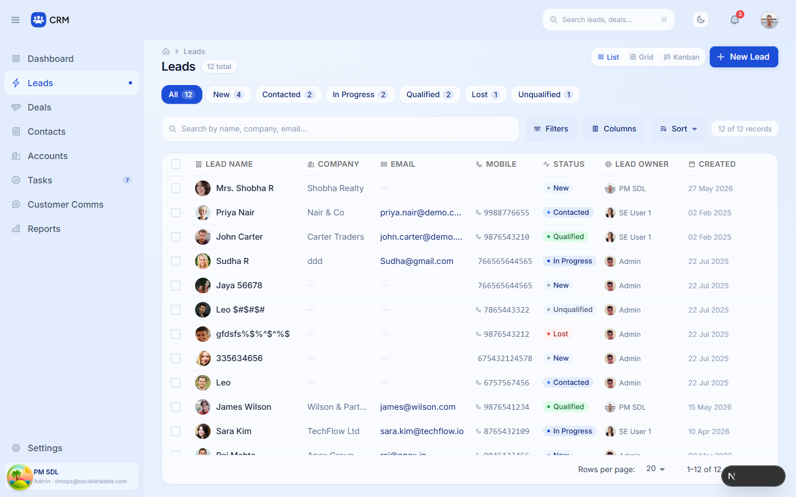 |  |
| 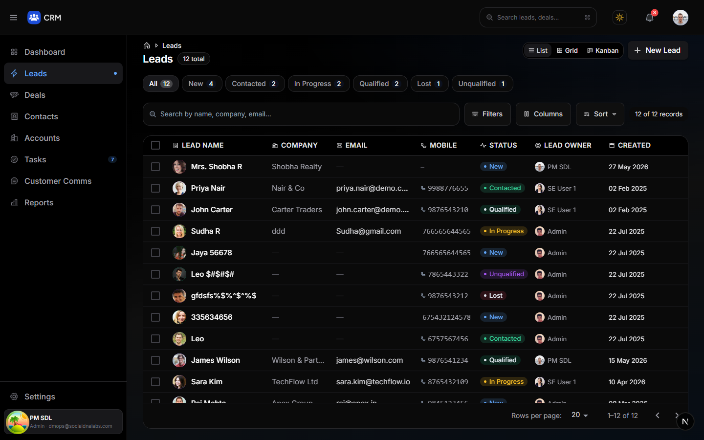 | 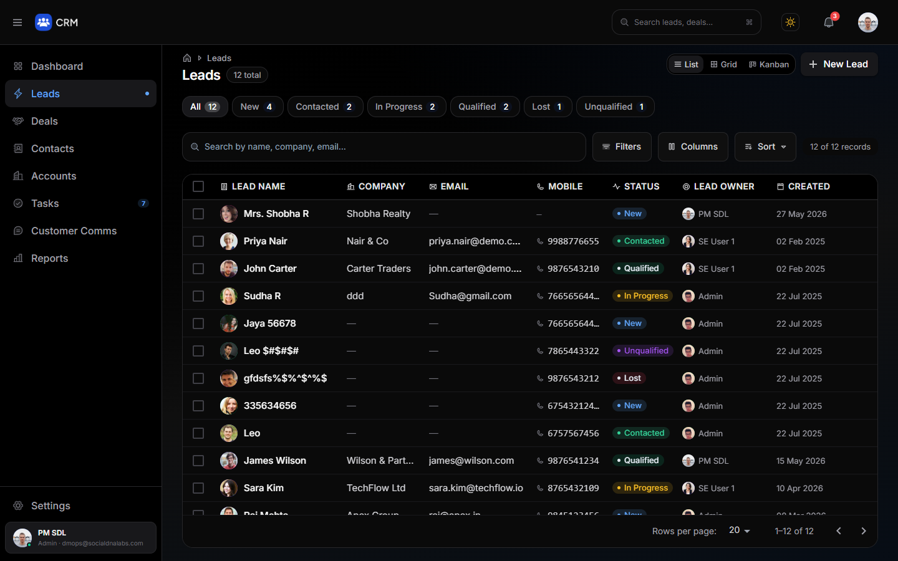 |

**Row hover (kebab revealed) — desktop**

| Before | After |
|---|---|
| 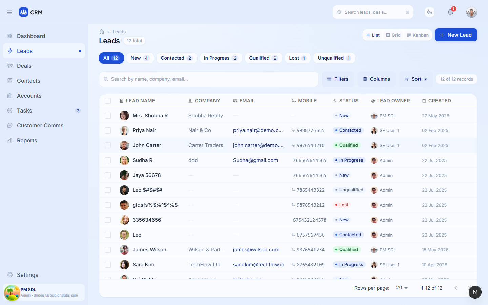 | 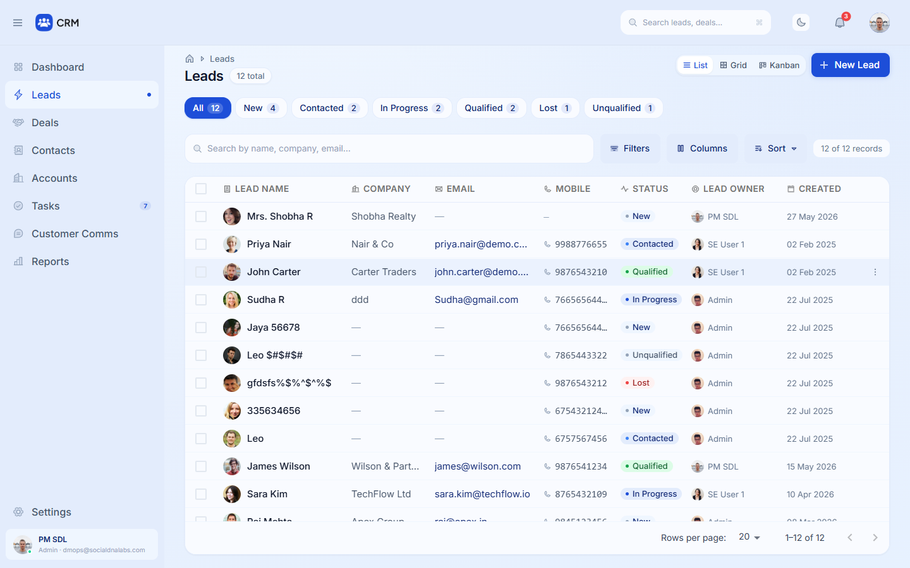 |

**Rows selected + bulk bar — desktop / mobile**

| Before | After |
|---|---|
| 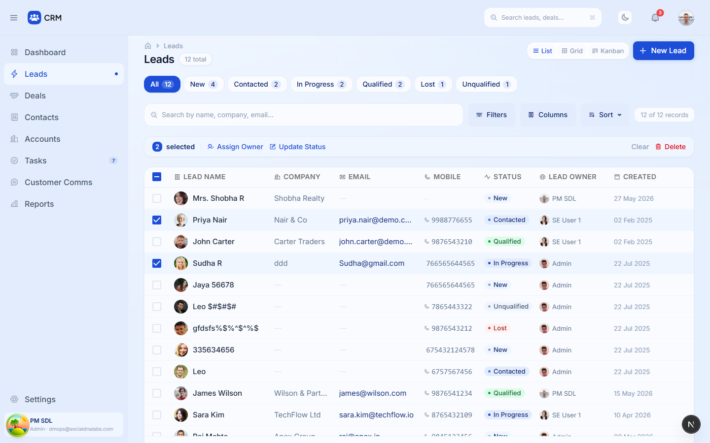 | 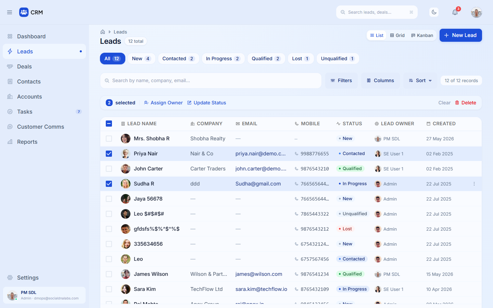 |
| 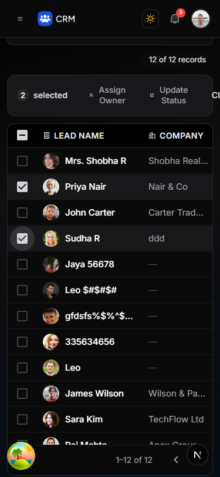 | 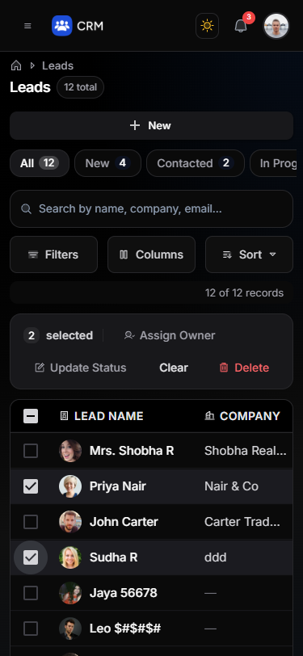 |

**Mobile 375 and tablet 768**

| Before | After |
|---|---|
| 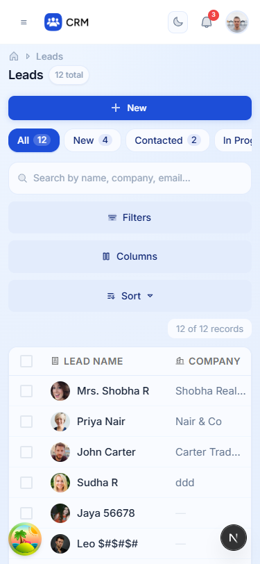 | 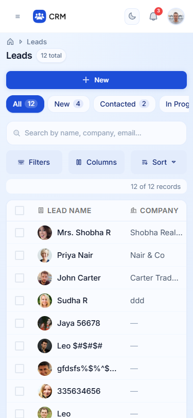 |
| 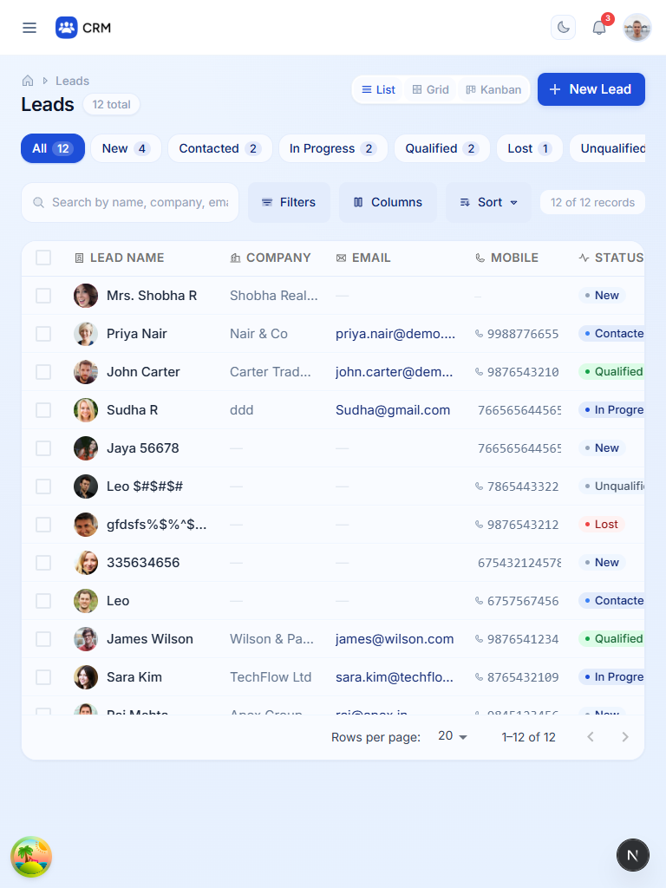 | 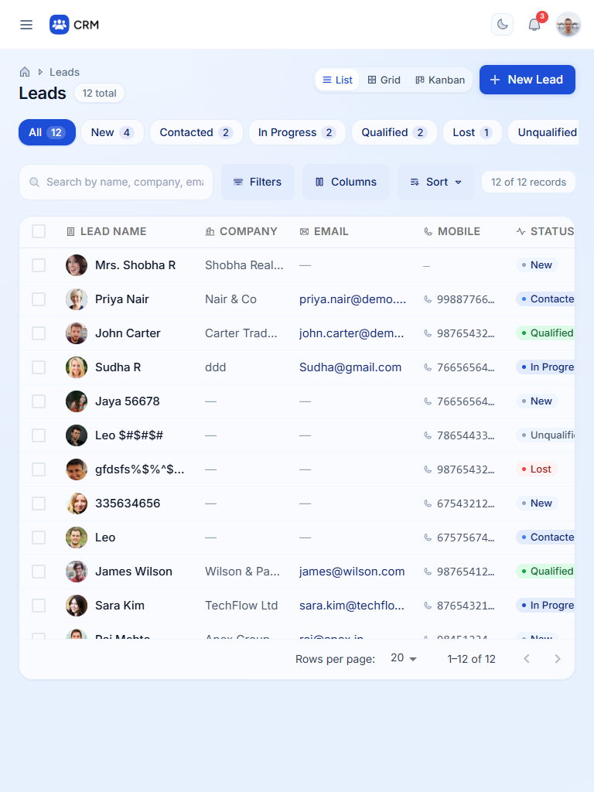 |

**Empty state — dark**

| Before | After |
|---|---|
| 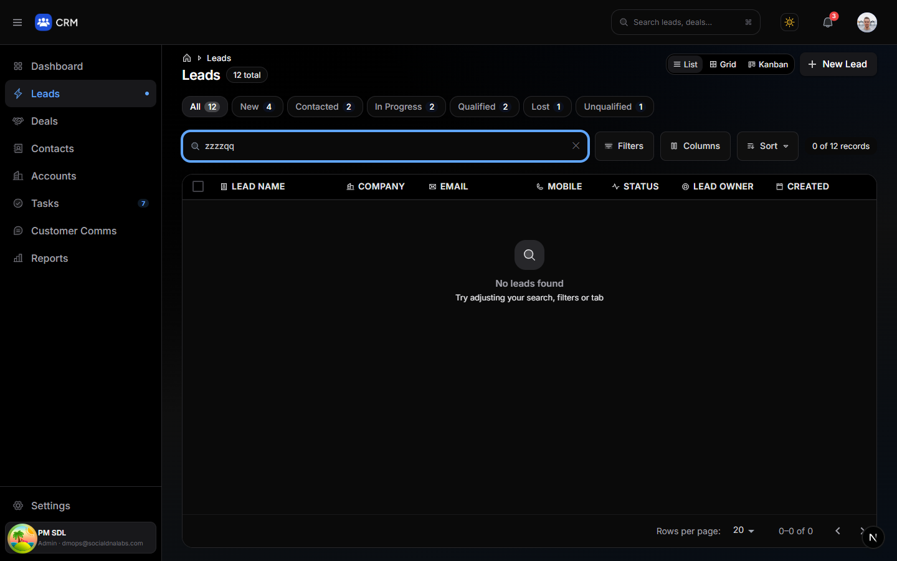 | 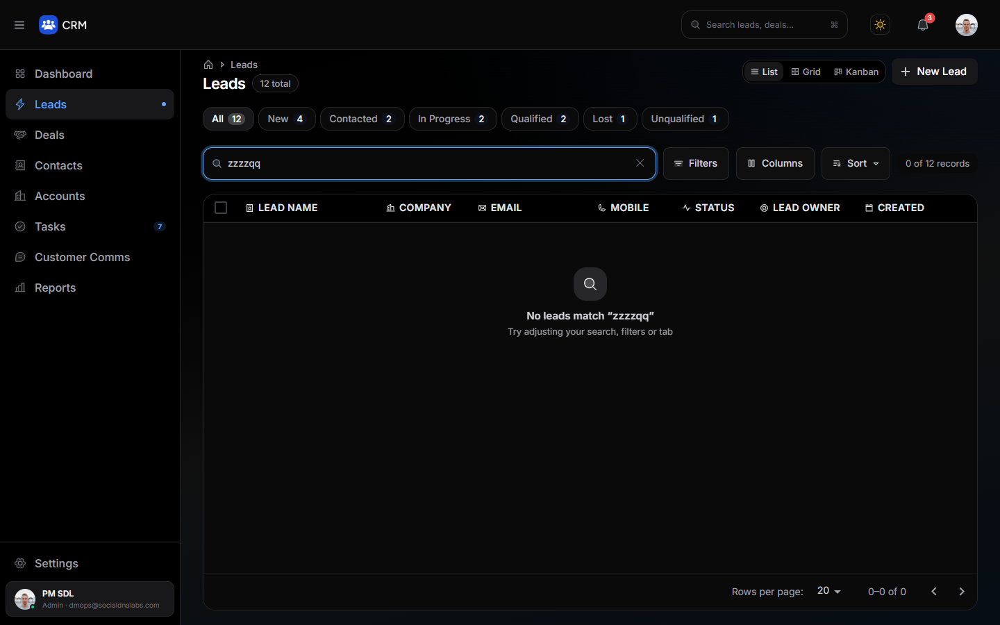 |

**Keyboard focus (toolbar)**

| Before | After |
|---|---|
|  |  |

Checkbox focus ring (after):  

## Contrast (computed from the actual colour tokens vs the surface they sit on)

**Light**

| Element | Before | After |
|---|---|---|
| Lead name (primary) | `#1E293B` 14.12:1 | `#0F172A` 17.23:1 |
| Company / email / mobile | `#64748B` 4.59:1 | `#475569` 7.31:1 |
| Created date | `#94A3B8` 2.48:1 | `#64748B` 4.59:1 |
| Empty-value dash — | `#E2E8F0` 1.19:1 | `#94A3B8` 2.48:1 |
| Breadcrumb + 'N total' pill | `#94A3B8` 2.48:1 | `#64748B` 4.59:1 |
| 'N of M records' | `#94A3B8` 2.48:1 | `#64748B` 4.59:1 |
| View toggle (inactive) | `#94A3B8` 2.36:1 | `#475569` 6.96:1 |
| Empty state title | `#64748B` 4.59:1 | `#334155` 10:1 |
| Empty state hint | `#CBD5E1` 1.43:1 | `#64748B` 4.59:1 |

**Dark** — hierarchy fixed: muted text is no longer brighter than the data; every item stays ≥ 4.1 : 1 (text ≥ 7.7 : 1).

| Element | Before | After |
|---|---|---|
| Lead name (primary) | `#FFFFFF` 19.8:1 | `#FAFAFA` 18.97:1 |
| Company / email / mobile | `#A1A1AA` 7.72:1 | `#D4D4D8` 13.4:1 |
| Created date | `#E4E4E7` 15.6:1 | `#A1A1AA` 7.72:1 |
| Empty-value dash — | `#52525B` 2.56:1 | `#71717A` 4.1:1 |
| Breadcrumb + 'N total' pill | `#E4E4E7` 15.6:1 | `#A1A1AA` 7.72:1 |
| 'N of M records' | `#E4E4E7` 15.6:1 | `#A1A1AA` 7.72:1 |
| View toggle (inactive) | `#E4E4E7` 16.55:1 | `#A1A1AA` 8.19:1 |
| Empty state title | `#A1A1AA` 7.72:1 | `#D4D4D8` 13.4:1 |
| Empty state hint | `#E4E4E7` 15.6:1 | `#A1A1AA` 7.72:1 |

(The empty-value dash is a non-text placeholder mark, raised from 1.19 to 2.48 : 1 in light mode.)

## Verification (production build, Chromium)

**Interaction regression — 70/70 pass, 0 console errors/warnings**

| Group | Result |
|---|---|
| Existing behaviour (both themes): initial render + counts, all 6 status tabs, search + clear, empty state, Filters / Columns / Sort panels, List / Grid / Kanban views, row click → detail, New Lead drawer, bulk Assign Owner / Update Status / Clear / Delete, row-menu Delete | 38/38 |
| Improvements: kebab on hover and on focus, visible hover tint, no focus layout shift, keyboard focus rings (toolbar, tabs, toggles, New Lead, grid cells, checkboxes), phone-icon alignment, ARIA | 16/16 |
| Responsive (320px, 375px, 414px, 768px, 1024px, 1280px, 1440px, 1920px), both themes: no horizontal overflow, no console errors | 16/16 |

**Build and types:** `tsc --noEmit` exit 0; `pnpm build` compiled, 16/16 pages generated.

## Notes and remaining items (not changed — out of scope)

- Whole-row click is the only way to open a lead; keyboard users still can't open a record from the list (Enter on a cell does nothing). That would be a behaviour change, so I left it — worth deciding in a later step.
- Row "Edit" in the row menu still just navigates to the detail page (existing behaviour).
- Very long numbers (e.g. the 14-digit test value) end with an ellipsis in the Mobile column; widening it would push Status off-screen on tablet.
- The bulk bar still appears above the table and pushes it down when rows are selected (existing, standard behaviour).
- Grid and Kanban views were reviewed but not changed; they inherit only the page-level text-contrast and focus fixes.
- Contacts, Accounts, Deals and Tasks lists use the identical "group-hover" kebab pattern (verified in code) and the shared faint hover, so they have the same hidden-kebab / faint-hover issues; Reports has no row kebab. Those are the natural next step once you approve this pattern.
