# Step 6 — Lead Detail page: UI/UX improvements

Local only: no Git, no deployment and no dependency changes. **No new features, buttons, fields, filters or actions. No changes to APIs, data, logic, permissions or workflows.**
Waiting for your review before Step 7.

## Files modified

| File | Change |
|---|---|
| `components/leads/LeadDetail.tsx` | All the changes: classes, `sx` props, ARIA attributes and semantic elements, plus one local tone/focus/layout token block and one local `RelatedList` sub-component. `RelatedList` replaces two copies of the same markup that were styled slightly differently. |

`app/leads/[id]/page.tsx` (the route) is unchanged. Nothing else was modified:

- Shared files are untouched: `globals.css`, `ThemeRegistry`, `Sidebar`/`TopBar`, and the `NewLeadDrawer` and `ConvertToDealDrawer` drawers (they are also used by the Leads list).
- Data, state, handlers and drawer props are unchanged line for line: the `LEADS` records, `STATUS_CFG`, `PIPELINE`, every `useState`, `addNote`, `handleRelatedClick`, the activity/task/call data, the menu options, and the props passed to the drawers.

## Baseline (before)

38 screenshots (2 themes × desktop 1440 / tablet 768 / mobile 375 × overview, timeline, stage changed, More menu, sparse lead, keyboard focus, related-list hover, Edit/Convert drawers, not found). I also measured horizontal overflow and checked the console. These are in `docs/step6/before-*`; metrics are in `before-metrics.json`.

## Audit and improvements

| # | Problem found (before) | Improvement (after) |
|---|---|---|
| 1 | **Mobile header overflowed by 71 px.** The action row could not wrap, so **Edit** was cut off at 375 px and the page scrolled sideways. | Name/company sit above the actions on narrow cards, and the actions wrap. 0 px overflow at every width from 320 to 1920. |
| 2 | **Tablet (641–1023 px) layout squeezed.** A global rule in `globals.css` rewrites `grid-cols-1` / `lg:grid-cols-3` to two equal 352 px columns. The main column got half the width: stat tiles truncated ("Man…"), the header wrapped "Apex / Group", and the stage pipeline broke onto 2 lines with Qualified alone. | The page uses its own column tracks, which the global rule doesn't touch: 1 column under 768 px, main column + 240 px side column at 768 px and up, 2 : 1 at 1024 px and up. Stat tiles, field grids, the stage pipeline and the header respond to their **own width** (container queries), so they adapt correctly at every breakpoint. **The global rule itself is unchanged**, so other pages are unaffected. |
| 3 | Stage pipeline wrapped unevenly on narrow screens (3 + 1 with a stray chevron). | A 2 × 2 grid of equal stage buttons when narrow, with Won/Lost below; one row with chevrons when wide. Pending stages now have an outline, so they read as clickable rather than plain text. |
| 4 | **Stage buttons had the wrong accessible name.** MUI `Tooltip` named every button after its tooltip, so screen readers announced "Click to set stage" ×3 / "Completed" instead of "Contacted", "In Progress"… | Each button is named by its stage, the tooltip becomes the description (`describeChild`), and the current stage has `aria-current="step"`. |
| 5 | **No usable keyboard focus.** MUI buttons showed only a faint ripple blob, and the tabs, stages, Won/Lost, related list, Undo, breadcrumb and back link relied on browser defaults. | The same 2 px focus ring as the Leads list (Step 5), shown for keyboard focus only, on every interactive element, including the More-menu items. |
| 6 | **Low or inverted text contrast.** In light mode, field labels, breadcrumb, Lead ID line, pending stages, timestamps and ownership meta were 2.4–2.5 : 1; the empty states ("No emails yet") 1.43 : 1; the related-list chevrons 1.19 : 1. In dark mode, empty states were 1.63 : 1. | The same tone system as Step 5 (primary > secondary > tertiary). Every text item measured is now ≥ 4.5 : 1 in both themes; see the tables below. |
| 7 | **Save Note button: white text on light blue (1.19 : 1).** The app theme forces `#fff` on contained buttons and the page set a light-blue background. | Brand-blue button with white text (6.7 : 1); neutral in dark mode. The note field text is 14 px (was 12.8 px) and it has an accessible label. |
| 8 | Edit hover went to light blue with white text (2.54 : 1). | Same Edit hover/active colours as the Step 5 "New Lead" button (5.17 : 1). Neutral dark-mode style, as on the Leads list. |
| 9 | The More (⋮) button looked disabled (grey icon, 2.48 : 1) and had no accessible name. | Readable icon (7.3 : 1), "More actions" tooltip and label, `aria-haspopup` / `aria-expanded` / `aria-controls`. "Delete Lead" uses a slightly deeper red for legibility. |
| 10 | Won/Lost were the 👍 / 👎 emoji, which render differently on every OS and stand out from the rest of the icon set. | Phosphor thumbs icons (same family as all other icons) in green/red tints, filled when active, with `aria-pressed`. Same tooltips and same action. |
| 11 | **Related-list jump links hid the section heading** under the fixed top bar (scrolled to y = 0, behind the 60 px bar). | Sections stop just below the top bar (`scroll-margin`); verified ≥ 60 px. |
| 12 | Dark mode was inconsistent: the header and Timeline cards used a different surface from every other card (`#0A0A0A` vs `#1C1C1E`); the stat tiles had bright white borders; the avatar status dot had a white ring. | One card surface (`#1C1C1E`, the same one the other detail pages use for section cards); subtle tile borders; the dot ring matches the card. |
| 13 | The quick-stat tiles touched the card below them on some widths, and the Ownership heading sat flush against the owner. | Consistent 16 px spacing between cards and 12 px inside them. |
| 14 | Long values (emails, 14-digit numbers, descriptions) could overflow narrow columns. The Description field was squeezed into half a column. | Values wrap safely, and Description spans the full width of its card. |
| – | Semantics | Breadcrumb `nav` with `aria-current`; `header`, `section`, `aside` and `nav` landmarks; card titles are real `h2` headings; fields are `dl`/`dt`/`dd`; notes, tasks, calls and timeline are lists; tabs have `aria-pressed`; the stage-changed banner is `role="status"`; related-list buttons announce counts ("Notes, 1"); decorative icons are hidden from screen readers. |

## Before / after

Screenshots are in `docs/step6/` (`before-*` / `after-*`).

**Overview, desktop 1440 (full page)**

| Before | After |
|---|---|
| 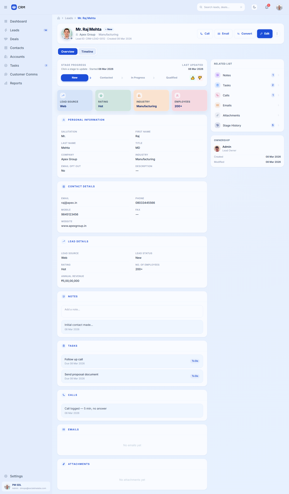 | 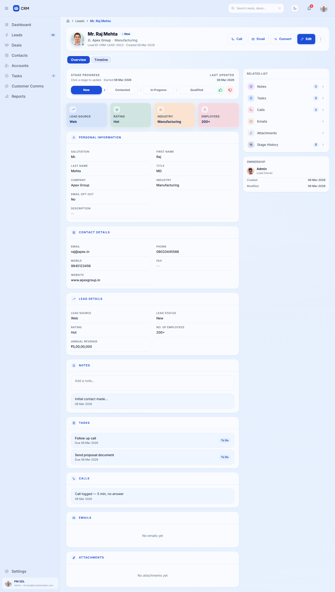 |
| 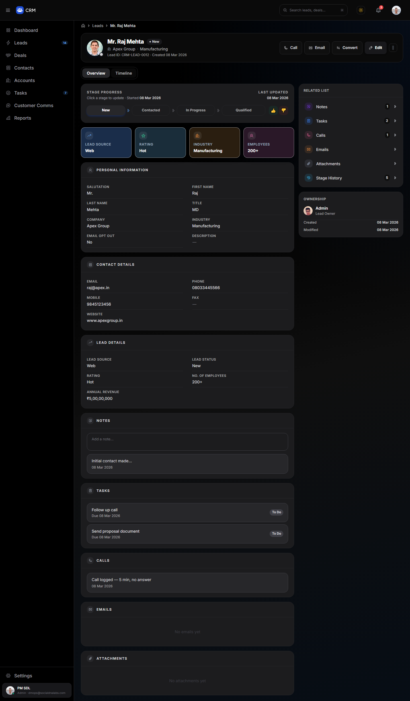 | 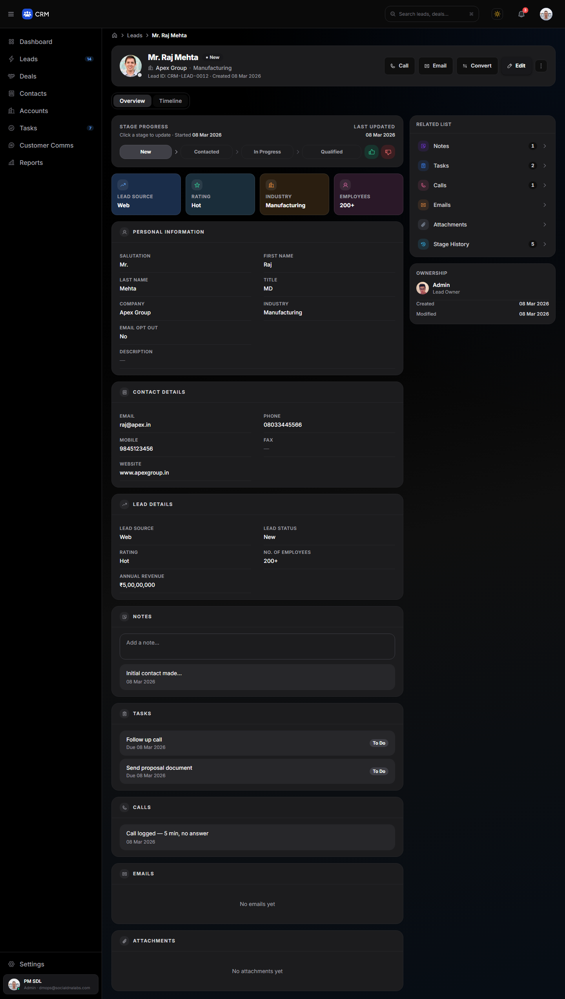 |

**Tablet 768**: two equal 352 px columns before; content column plus side column after

| Before | After |
|---|---|
| 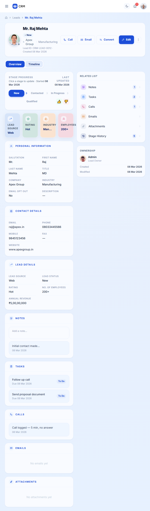 | 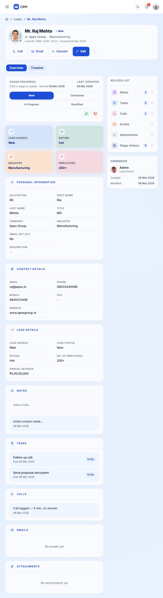 |
| 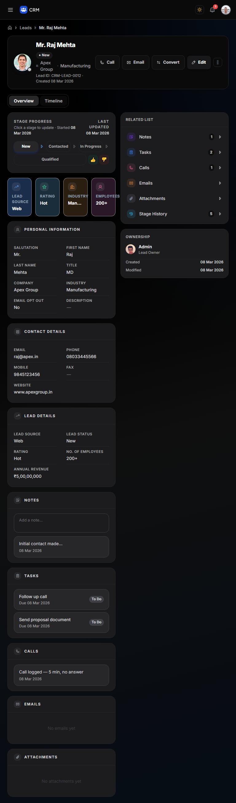 | 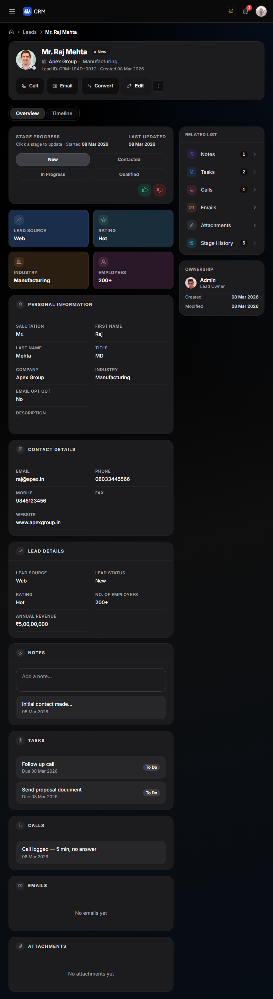 |

**Mobile 375**: Edit was cut off and the page scrolled sideways before

| Before | After |
|---|---|
| 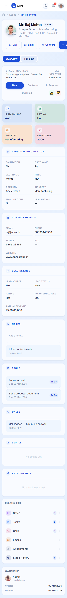 | 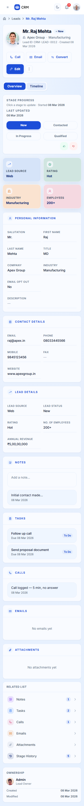 |
| 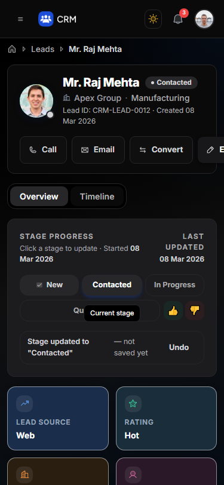 | 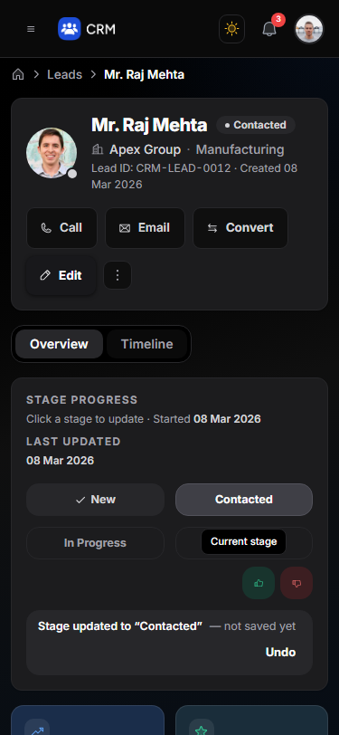 |

**Stage changed (not saved) banner, desktop**

| Before | After |
|---|---|
| 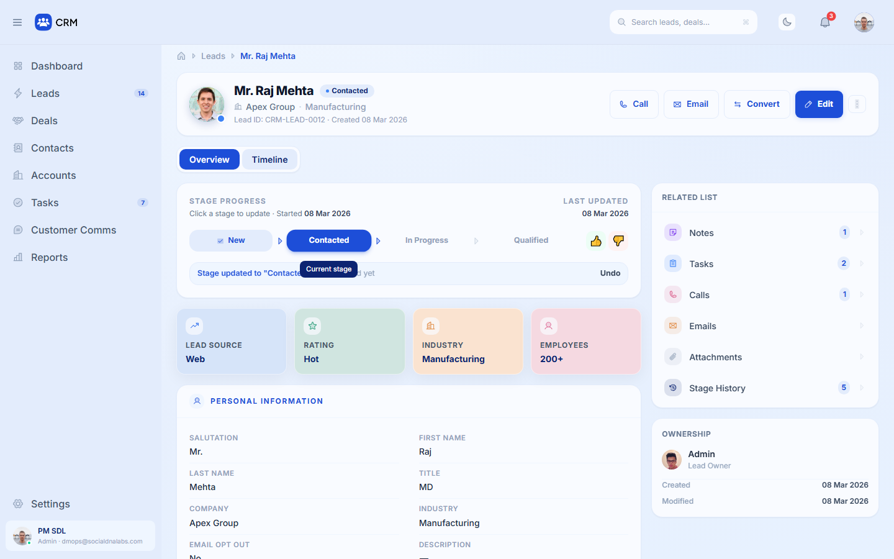 |  |

**Keyboard focus (header actions)**

| Before | After |
|---|---|
| 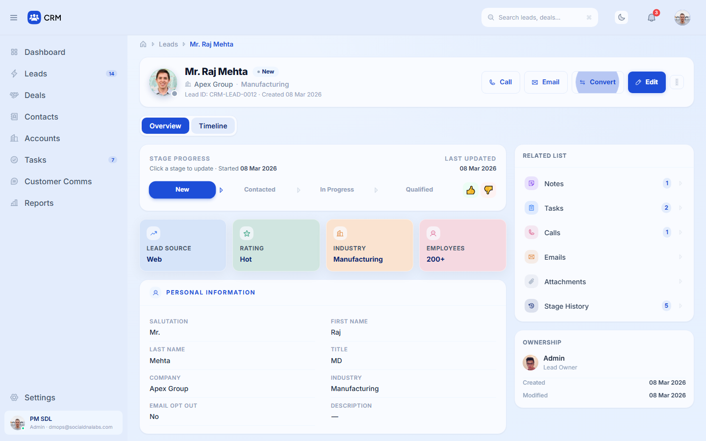 | 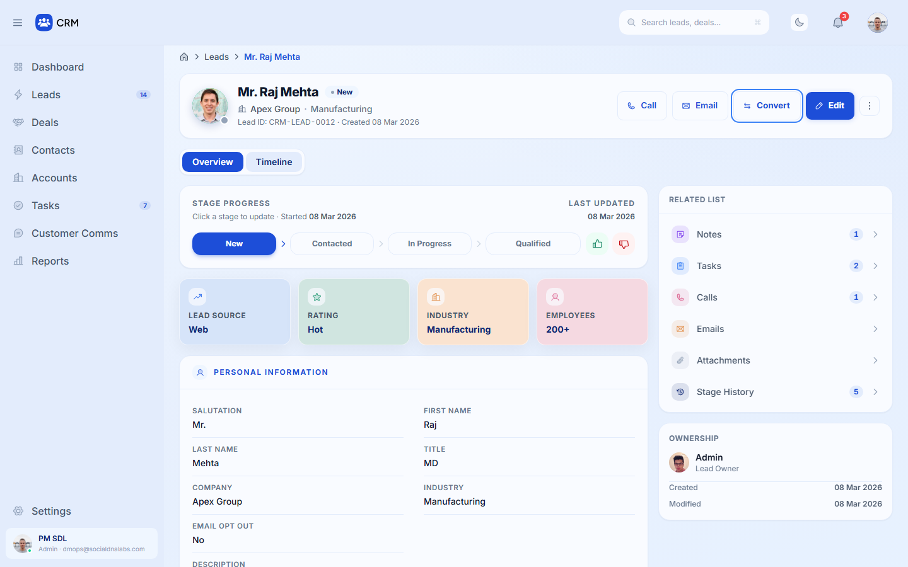 |
| 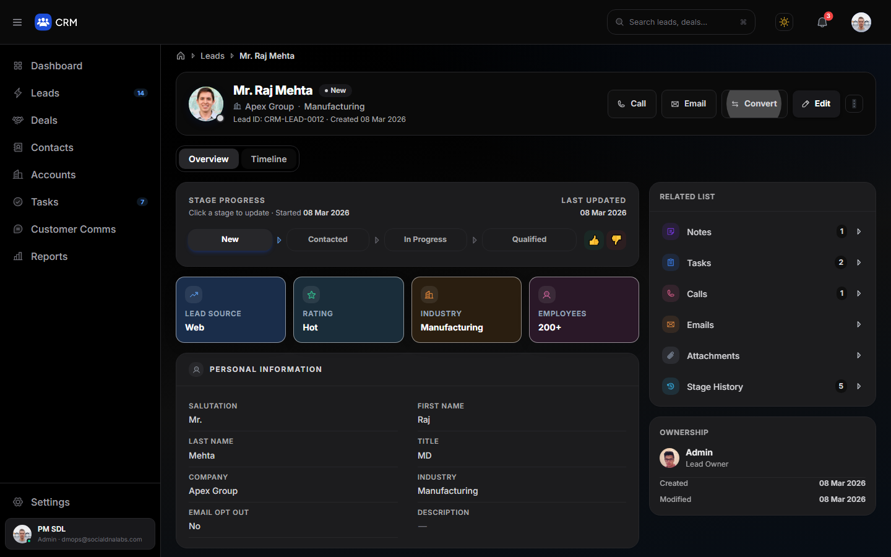 | 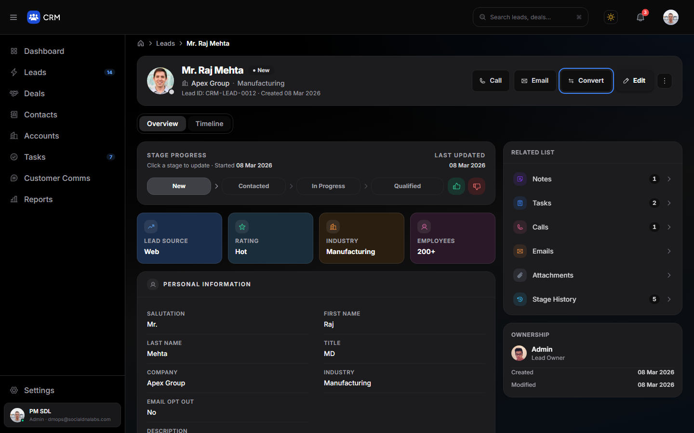 |

**Timeline tab and More menu, dark**

| Before | After |
|---|---|
| 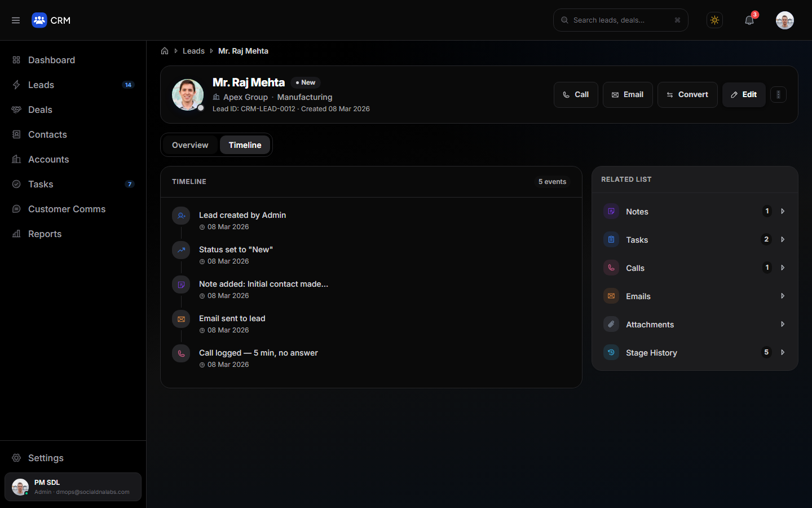 | 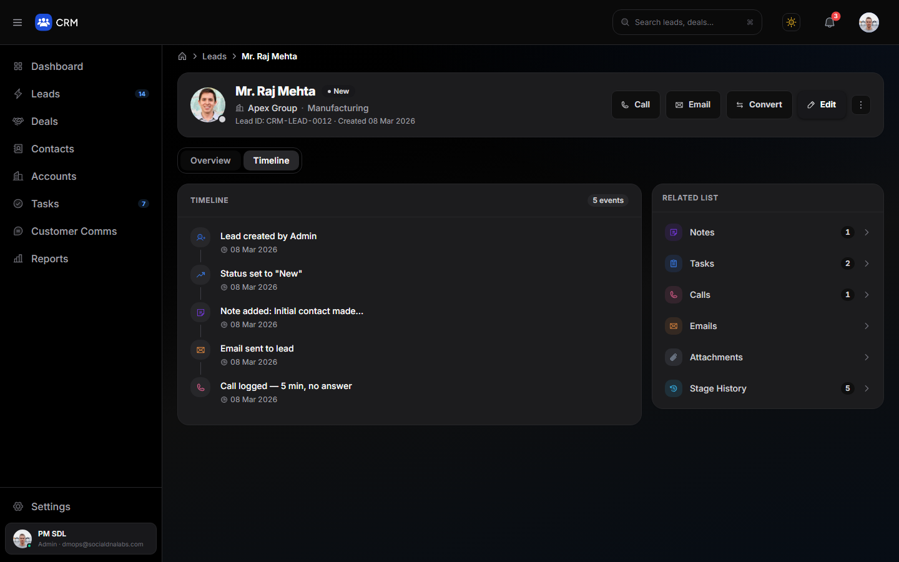 |
| 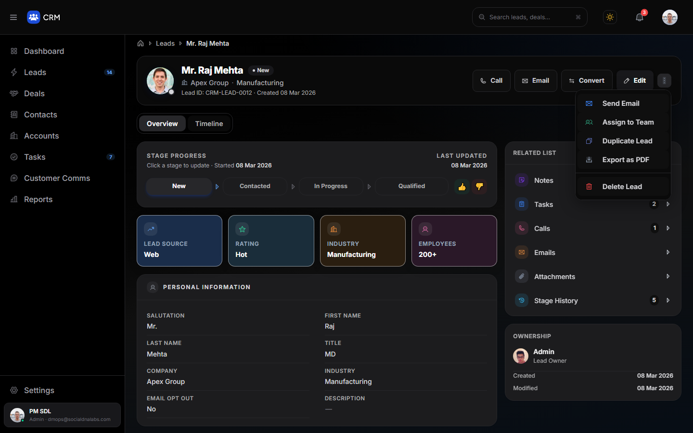 | 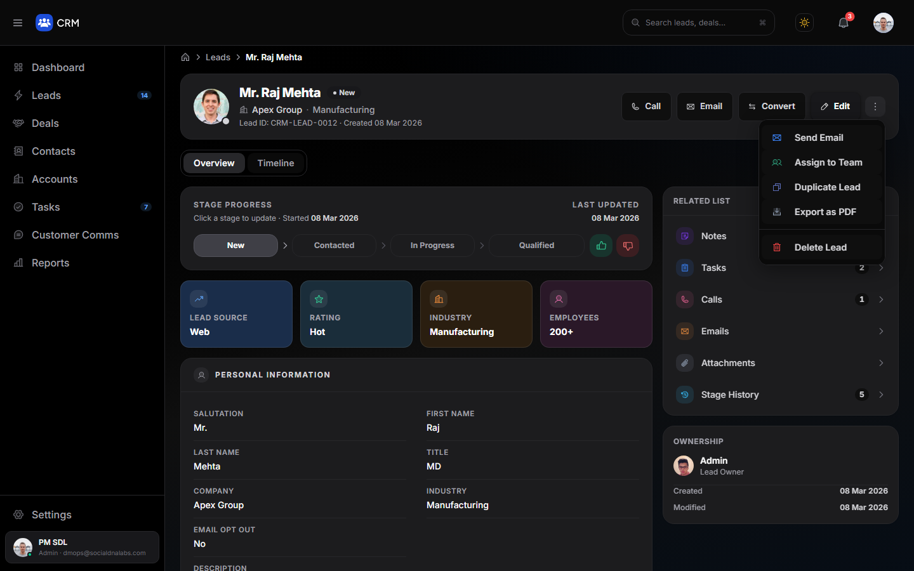 |

**Sparse lead (many empty fields), mobile**

| Before | After |
|---|---|
| 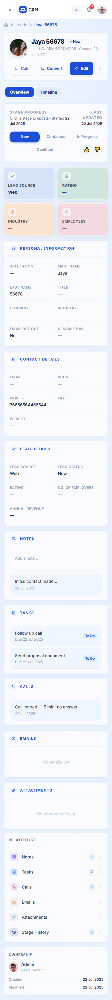 | 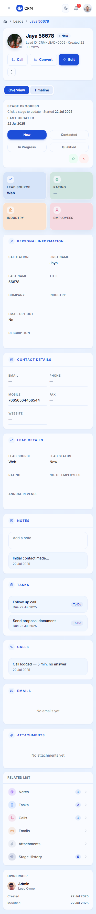 |

The Edit and Convert drawers and the not-found state were captured before and after (`*-edit-drawer`, `*-convert-drawer`, `*-not-found`). The drawers are identical because they weren't modified.

## Contrast

Ratios are computed from the colour tokens against the surface each item sits on. The "after" values were also measured from the rendered page (`lead-detail-reg.json`).

**Light** (card surface `#F9FBFF`, tinted rows/canvas `#EFF6FF`)

| Element | Before | After |
|---|---|---|
| Lead name | `#0F172A`* 17.2:1 | `#0F172A` 17.23:1 |
| Field labels | `#94A3B8` 2.48:1 | `#64748B` 4.59:1 |
| Breadcrumb | `#94A3B8` 2.36:1 | `#475569` 6.96:1 |
| Lead ID / created line, industry | `#94A3B8` 2.48:1 | `#64748B` 4.59:1 |
| Pending stage labels | `#94A3B8` 2.48:1 | `#64748B` 4.59:1 |
| Section / side-card titles (Stage Progress, Related List, Ownership) | `#94A3B8` 2.48:1 | `#64748B` 4.59:1 |
| Note / task / call timestamps (tinted rows) | `#94A3B8` 2.36:1 | `#475569` 6.96:1 |
| Empty state ("No emails yet") | `#CBD5E1` 1.43:1 | `#64748B` 4.59:1 |
| Empty-value dash — (non-text mark) | `#CBD5E1` 1.43:1 | `#94A3B8` 2.48:1 |
| Related-list chevron (non-text) | `#E2E8F0` 1.19:1 | `#94A3B8` 2.48:1 |
| More (⋮) icon | `#94A3B8` 2.48:1 | `#475569` 7.31:1 |
| Save Note label | white on `#E3ECFC` 1.19:1 | white on `#1D4ED8` 6.70:1 |
| Edit (hover) | white on `#60A5FA` 2.54:1 | white on `#2563EB` 5.17:1 |

\* `text-slate-900` in the original.

**Dark** (card `#1C1C1E`): the hierarchy is kept, and every text item stays ≥ 5.8 : 1.

| Element | Before | After |
|---|---|---|
| Field labels / meta | `#ABABAD` / `#9CA3AF` 6.7–7.4:1 | `#A1A1AA` 6.64:1 (one shared tertiary tone) |
| Empty state ("No emails yet") | `#3F3F46` **1.63:1** | `#A1A1AA` 6.64:1 |
| Empty-value dash — (non-text) | `#71717A` 3.52:1 | `#71717A` 3.52:1 |
| Related-list chevron | `#E2E8F0` 13.8:1 (louder than the labels) | `#71717A` 3.52:1, brightening on hover |

## Verification (production build, Chromium, served locally on port 3100; your dev server on 3000 was not touched)

**Regression suite: 74/74 pass, 0 console errors or warnings** (`docs/step6/lead-detail-reg.json`)

| Group | Result |
|---|---|
| Existing behaviour, both themes: render + Lead ID; quick stats + field values + ₹ formatting; Call/Email shown only when phone/email exist (leads 12 / 5 / 1); empty values for a sparse lead; breadcrumb → /leads; Convert drawer open/close; Edit drawer opens pre-filled; More menu with 5 actions, closes on select; Timeline/Overview tabs (5 events); stage click updates pill + Lead Status + "not saved yet" banner; completed ✓ on earlier stages; Undo; Won → Qualified; Lost → Lost; add note (Save hidden when empty, prepends "Just now", Notes count 1 → 2); related-list jump (Tasks), Stage History → Timeline, Timeline → Calls jump; unknown id → "Lead not found" → back to /leads | 36/36 |
| Improvements, both themes: More-button name + `aria-expanded`; tab `aria-pressed`; Won/Lost `aria-pressed`; stage buttons named by stage; note field label; section heading clears the top bar; 2 px focus ring on a 9-stop Tab sequence; Enter on tab/stage works; related-list focus ring; More menu by keyboard (focus moves in, Esc returns it); clean console | 22/22 |
| Responsive, 320 / 375 / 414 / 768 / 1024 / 1280 / 1440 / 1920 px × both themes, leads 12, 5 and 4, both tabs: no horizontal overflow, no control past the content edge, no console errors | 16/16 |

**Build and types:** `tsc --noEmit` exit 0; `next build` compiled and generated 16/16 pages.

## Known limitations and remaining items (not changed: out of scope)

- **Buttons that do nothing are unchanged.** Call, Email, and four of the More-menu items (Send Email, Assign to Team, Duplicate, Export as PDF) still only close the menu. Delete Lead also just closes it. Wiring them up would be new functionality.
- Stage changes and notes are local UI state ("not saved yet" banner); there is no save. This is existing behaviour.
- Email and Website values are still plain text, not `mailto:`/links (the old `blue` prop never changed anything). Making them links would be a new interaction.
- The **global tablet rule** in `globals.css` (two equal columns between 641 and 1023 px) still applies to other modules. Lead Detail now avoids it; whether other detail pages should too is worth deciding in a later step.
- On phones, the Related List and Ownership cards stay at the bottom of the page, after all sections (same order as before). Moving them up would change the reading order.
- The Edit and Convert drawers were not restyled, because they are shared with the Leads list. Both open and close correctly.
- The baseline's existing-behaviour checks were done in the before screenshots (all states captured) rather than by running this exact suite against the old build. The suite was written against the unchanged handlers and data, which are identical before and after.

## Outside Step 6 (from the earlier dev-server fix in this session)

`git status` also shows changes I made before Step 6 while fixing your `npm run dev` error:

- `package.json`: the `magic-string` override. It's no longer needed on Node 26 and can be removed.
- `package-lock.json`: untracked.
- `tsconfig.tsbuildinfo`: build cache.

None of these belong to Step 6.
