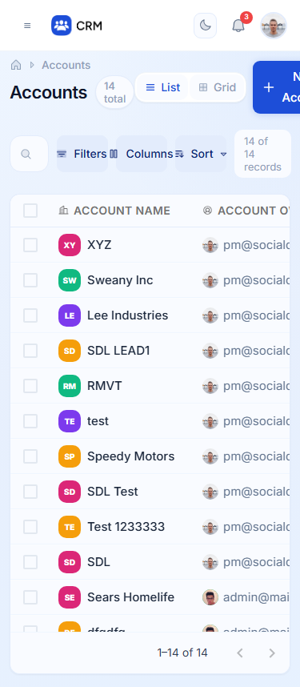
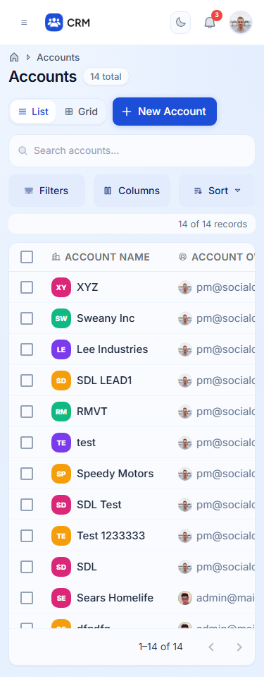
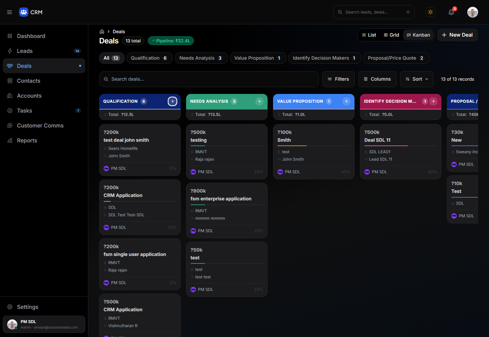
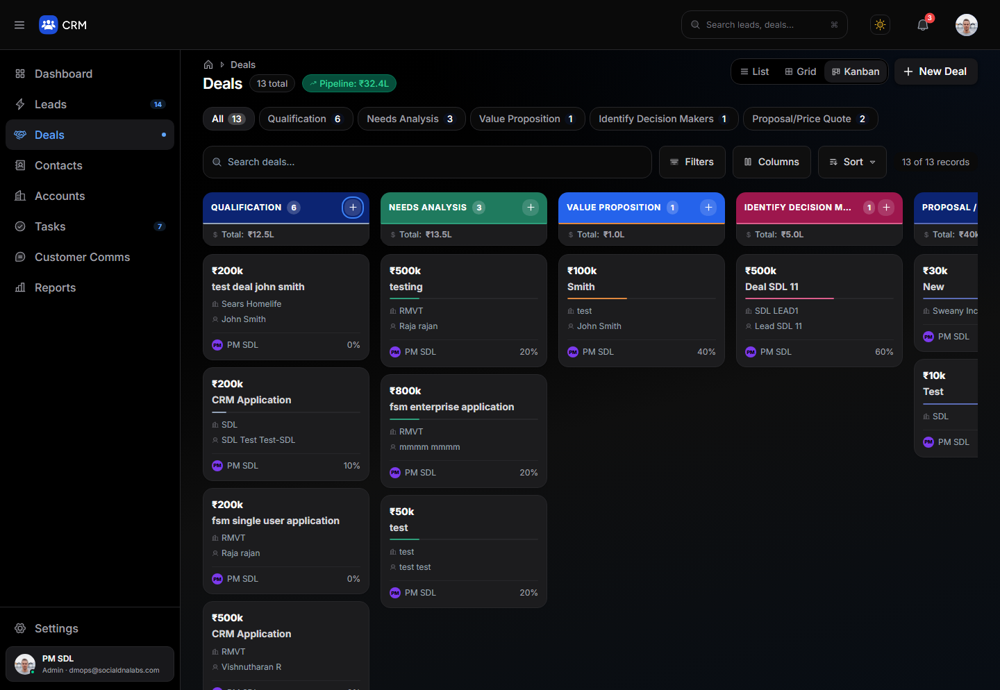
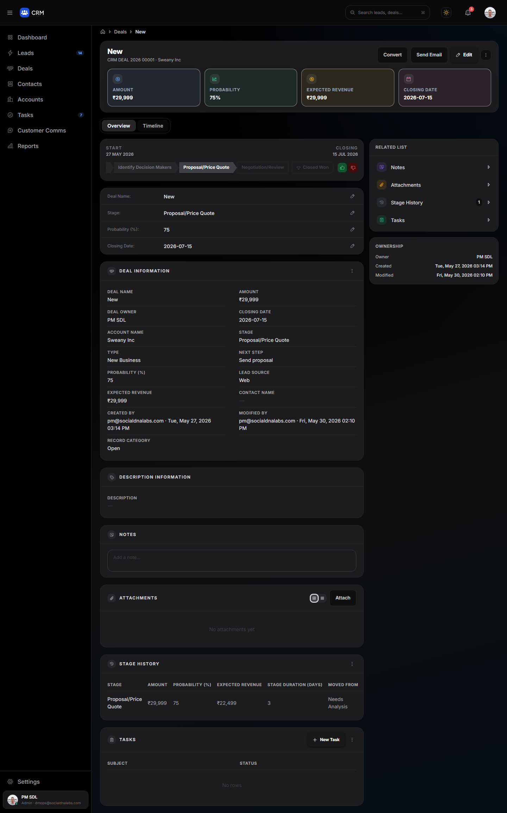
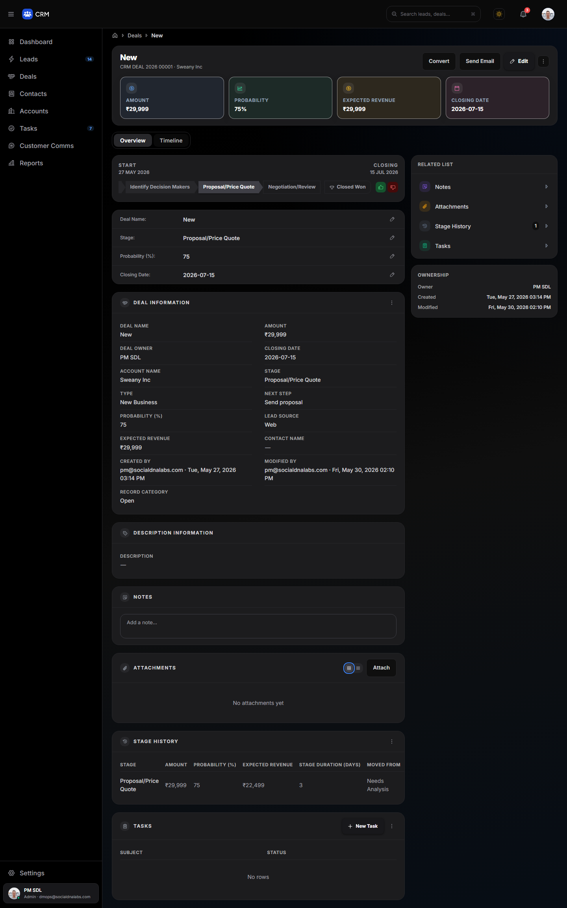

# Step 7 — UI/UX standards applied across all remaining CRM pages

Local only. No Git, deployment, dependency or package-manager changes. **No new features, buttons, fields, filters, actions or workflows. No changes to APIs, data, routes, navigation, permissions or business logic.** Incomplete functionality was left as it was (see *Known limitations*).
Waiting for your review before Step 8.

The reference standards are the Leads list (Step 5) and Lead Detail (Step 6). Neither of those two files was changed in this step.

## 1. Route and module inventory

All 22 routes were audited, plus their sub-views (list / grid / kanban, and the 11 Settings sections): **39 audited states** × light and dark × desktop 1440, tablet 768 and mobile 375. The sign-in pages are light-only by design.

| Module | Routes / states | Main components |
|---|---|---|
| Dashboard | `/` | `app/page.tsx`, `components/dashboard/*` (KPICard, RevenueChart, DealStageChart, RecentDeals, ActivityFeed) |
| Leads (Steps 5 and 6, regression-checked only) | `/leads` (list / grid / kanban), `/leads/[id]` | Leads sub-screens updated in Step 7: `LeadGridView`, `LeadKanbanView`, `FiltersDrawer`, `ColumnsDrawer`, `SortPopover`, `NewLeadDrawer`, `ConvertToDealDrawer` |
| Deals | `/deals` (list / grid / kanban), `/deals/[id]` | `app/deals/page.tsx`, `DealGridView`, `DealKanbanView`, `DealDetail`, `NewDealDrawer` |
| Accounts | `/accounts` (list / grid), `/accounts/[id]` | `app/accounts/page.tsx`, `AccountGridView`, `AccountDetail`, `NewAccountDrawer` |
| Contacts | `/contacts` (list / grid), `/contacts/[id]` | `app/contacts/page.tsx`, `ContactGridView`, `ContactDetail`, `NewContactDrawer` |
| Tasks | `/tasks` (list / grid), `/tasks/[id]` | `app/tasks/page.tsx`, `TaskGridView`, `TaskDetail`, `NewTaskDrawer` |
| Reports | `/reports`, `/reports/[id]`, `/reports/[id]/edit` (report builder), `/reports/create` | `app/reports/**`, `components/reports/*` |
| Settings | `/settings` and its 11 sections (Personal, Users, Organization, Roles, Permissions, Email, Modules & Fields, Dashboard Customization, Import, Export, Data Backup); `/home/[id]/edit` (dashboard editor) | `app/settings/page.tsx`, `app/home/[id]/edit/page.tsx` |
| Customer Comms | `/comms` ("coming soon" placeholder) | `app/comms/page.tsx` |
| Auth (light-only) | `/login`, `/register`, `/forgot-password` | `app/{login,register,forgot-password}/page.tsx` |
| Shell | every page | `Sidebar`, `AppHeader`, `TopBar`, `ThemeRegistry`, `globals.css` |

**Calls and Meetings:** the only Calls section is on Lead Detail (done in Step 6). "Meetings" appears only as a dashboard banner stat, which is covered below. No other page has a Calls or Meetings section.

**Baseline functionality recorded before any change:** 38 baseline screenshots per theme/size set, 225 in total, plus per-page measurements: contrast of every text element, keyboard-focus visibility over 25 Tab stops, horizontal overflow and console errors. In the baseline, no page had console errors. Mobile overflow existed on Accounts (53 px) and Contacts (44 px).

## 2. Files modified and why

**Shared (new or extended; impact assessed on every route):**

| File | Change | Impact |
|---|---|---|
| `lib/ui.ts` (new) | The Step 5/6 tokens in one place: text tones, focus ring, card surface, detail-page grid, field grid, button styles | Only affects files that import it |
| `lib/dataGridStyles.ts` | Added `getListGridRefinementsSx` / `listGridSx`, the Leads-list grid refinements from Step 5 (clearer hover and selection, row actions shown on hover / focus / touch, visible unchecked checkboxes, cell and checkbox focus rings). **`getDataGridSx` is unchanged.** | Used by Accounts, Contacts, Deals, Tasks and Reports lists; the Leads list keeps its own identical copy |
| `app/globals.css` | One `:focus-visible` rule for native interactive elements (2 px `#3B82F6` ring, keyboard-only, zero specificity so components can still override) | All pages; Leads pages already used the same ring, so they look the same |
| `components/ThemeRegistry.tsx` | The same ring for every MUI control (`MuiButtonBase`), drawn inside the bounds of menu items, checkboxes, switches, tabs and list items. Unchecked checkbox colour `#E2E8F0` → `#94A3B8` (dark `#52525B` → `#71717A`); it was barely visible (≈1.2 : 1) | All MUI controls app-wide; verified on every route |

**Module files**, with the reasons:

| Area | Files | What changed |
|---|---|---|
| Text contrast (all modules) | 45 files across `app/**` and `components/**` (not the Leads list or Lead Detail) | A rule-based, context-checked codemod (586 lines). Light: `slate-400` → `slate-500`, `slate-300` → `slate-500`, with `slate-400` kept for dash marks. Dark: the near-invisible `#3F3F46` / `#52525B` / `#71717A` text → `#A1A1AA`, and the inverted meta text `#E4E4E7` → `#A1A1AA`. Unreadable icon buttons (`#E2E8F0` / `#3F3F46`) → `#64748B` / `#A1A1AA`. Edit-button hover `#60A5FA` (2.5 : 1) → `#2563EB`. Then targeted fixes where text sits on tinted surfaces (breadcrumbs, sidebar footer, card meta), on coloured pills (Tasks priority, KPI trend badges, "Pipeline" pill, Permissions role pills, Deals-kanban column headers) and on the sign-in form labels |
| List pages (Step 5 pattern) | `app/{accounts,contacts,deals,tasks,reports}/page.tsx` | Row ⋮ actions: shown on row hover, keyboard focus and touch, named "Actions for &lt;record&gt;" (they were permanently invisible). `listGridSx`. Responsive page padding and header. Toolbar wraps, with search full-width and Filters / Columns / Sort in an even 3-up row on phones. Labelled search with a "Clear search" button. `aria-pressed` on view toggles and stage/status tabs. Live record count. Bulk bar is a labelled toolbar and wraps. Empty state has `role="status"`. Readable search focus without layout shift |
| Detail pages (Step 6 pattern) | `components/{deals,accounts,contacts,tasks}/*Detail.tsx` | **Grid avoids the global tablet rule** (it forced two cramped equal columns between 641 and 1023 px). Header actions wrap on phones. Sticky side panel no longer slides under the fixed top bar (`top-4` → below the bar). Jump links stop below the top bar (`scroll-margin`). Field grids are responsive and long values wrap. Quick-info rows don't overflow on phones. Tabs have `aria-pressed`. Icon-only buttons are named ("More actions", "Edit &lt;field&gt;", attachment view toggles with `aria-pressed`). Task field-edit pencils are also revealed on keyboard focus and touch, not only on mouse hover |
| Grid / Kanban views | `DealGridView`, `DealKanbanView`, `TaskGridView`, `LeadKanbanView`, `AccountGridView`, `ContactGridView`, `LeadGridView` | Dark-mode amounts are now primary text (they were the dimmest text on the card). Readable meta text. Card ⋮ named and revealed on focus or touch. **Deals Kanban showed "?29k" / "?0": a corrupted ₹ sign is restored.** Column headers ≥ 4.5 : 1. "Add lead" is no longer 60%-transparent |
| Dashboard | `app/page.tsx`, `components/dashboard/KPICard.tsx` (+ codemod) | **The banner stat labels ("Tasks due today", "Meetings today" …) never rendered at any width** (`hidden xs:inline`, but there's no `xs` breakpoint). They now show from 640 px up and stay available to screen readers on phones. Charts and bottom rows go full width on tablet instead of two cramped columns. Dashboard switcher has `aria-haspopup` / `aria-expanded`. KPI trend badge 1.9 : 1 → 4.5 : 1+ |
| Reports | `app/reports/page.tsx`, `app/reports/[id]/page.tsx`, `app/reports/create/page.tsx` (+ codemod for the builder components) | List gets the Step 5 pattern. Pin buttons named with `aria-pressed`. Sidebar categories get `aria-expanded`, a **visible keyboard focus** (it was suppressed by `outline-hidden`) and readable dark headers (`#475569`, 2.5 : 1 → `#A1A1AA`). `/reports/create` (a copy of the dashboard) gets the same tablet grid fix |
| Settings | `app/settings/page.tsx`, `app/home/[id]/edit/page.tsx` | Section nav: **keyboard focus was never visible** (the `ring-2` never rendered and `outline-hidden` hid the global ring), so there's now an explicit ring, `aria-expanded` on groups, `aria-current` on the active section, and readable dark headers. Custom switches: `role="switch"` + `aria-checked`, a visible focus ring, and an off-track that is visible in both themes (it was a bright `#E2E8F0` in dark mode). Field "remove" buttons are named and revealed on focus or touch. Permissions role pills meet 4.5 : 1. Dashboard editor trend badges and Cancel text are readable |
| Shell / auth / comms | `Sidebar`, `TopBar`, `AppHeader`, sign-in pages, `/comms` | Contrast only (codemod and sidebar footer); sign-in field labels `#94A3B8` → `#64748B` |

## 3. Before / after screenshots

The curated pairs below (18 key routes × light desktop, dark desktop and light mobile) are in `docs/step7/`. Every screenshot is a full-page capture.

| Route | Light desktop | Dark desktop | Light mobile 375 |
|---|---|---|---|
| Dashboard | [before](step7/before-light-desktop-dashboard.png) · [after](step7/after-light-desktop-dashboard.png) | [before](step7/before-dark-desktop-dashboard.png) · [after](step7/after-dark-desktop-dashboard.png) | [before](step7/before-light-mobile-dashboard.png) · [after](step7/after-light-mobile-dashboard.png) |
| Deals list | [before](step7/before-light-desktop-deals.png) · [after](step7/after-light-desktop-deals.png) | [before](step7/before-dark-desktop-deals.png) · [after](step7/after-dark-desktop-deals.png) | [before](step7/before-light-mobile-deals.png) · [after](step7/after-light-mobile-deals.png) |
| Deals kanban | [before](step7/before-light-desktop-deals-kanban.png) · [after](step7/after-light-desktop-deals-kanban.png) | [before](step7/before-dark-desktop-deals-kanban.png) · [after](step7/after-dark-desktop-deals-kanban.png) | – (not offered on mobile) |
| Deal detail | [before](step7/before-light-desktop-deal-detail.png) · [after](step7/after-light-desktop-deal-detail.png) | [before](step7/before-dark-desktop-deal-detail.png) · [after](step7/after-dark-desktop-deal-detail.png) | [before](step7/before-light-mobile-deal-detail.png) · [after](step7/after-light-mobile-deal-detail.png) |
| Accounts list | [before](step7/before-light-desktop-accounts.png) · [after](step7/after-light-desktop-accounts.png) | [before](step7/before-dark-desktop-accounts.png) · [after](step7/after-dark-desktop-accounts.png) | [before](step7/before-light-mobile-accounts.png) · [after](step7/after-light-mobile-accounts.png) |
| Account detail | [before](step7/before-light-desktop-account-detail.png) · [after](step7/after-light-desktop-account-detail.png) | [before](step7/before-dark-desktop-account-detail.png) · [after](step7/after-dark-desktop-account-detail.png) | [before](step7/before-light-mobile-account-detail.png) · [after](step7/after-light-mobile-account-detail.png) |
| Contacts list | [before](step7/before-light-desktop-contacts.png) · [after](step7/after-light-desktop-contacts.png) | [before](step7/before-dark-desktop-contacts.png) · [after](step7/after-dark-desktop-contacts.png) | [before](step7/before-light-mobile-contacts.png) · [after](step7/after-light-mobile-contacts.png) |
| Contact detail | [before](step7/before-light-desktop-contact-detail.png) · [after](step7/after-light-desktop-contact-detail.png) | [before](step7/before-dark-desktop-contact-detail.png) · [after](step7/after-dark-desktop-contact-detail.png) | [before](step7/before-light-mobile-contact-detail.png) · [after](step7/after-light-mobile-contact-detail.png) |
| Tasks list | [before](step7/before-light-desktop-tasks.png) · [after](step7/after-light-desktop-tasks.png) | [before](step7/before-dark-desktop-tasks.png) · [after](step7/after-dark-desktop-tasks.png) | [before](step7/before-light-mobile-tasks.png) · [after](step7/after-light-mobile-tasks.png) |
| Task detail | [before](step7/before-light-desktop-task-detail.png) · [after](step7/after-light-desktop-task-detail.png) | [before](step7/before-dark-desktop-task-detail.png) · [after](step7/after-dark-desktop-task-detail.png) | [before](step7/before-light-mobile-task-detail.png) · [after](step7/after-light-mobile-task-detail.png) |
| Reports | [before](step7/before-light-desktop-reports.png) · [after](step7/after-light-desktop-reports.png) | [before](step7/before-dark-desktop-reports.png) · [after](step7/after-dark-desktop-reports.png) | [before](step7/before-light-mobile-reports.png) · [after](step7/after-light-mobile-reports.png) |
| Report detail | [before](step7/before-light-desktop-report-detail.png) · [after](step7/after-light-desktop-report-detail.png) | [before](step7/before-dark-desktop-report-detail.png) · [after](step7/after-dark-desktop-report-detail.png) | [before](step7/before-light-mobile-report-detail.png) · [after](step7/after-light-mobile-report-detail.png) |
| Report builder | [before](step7/before-light-desktop-report-edit.png) · [after](step7/after-light-desktop-report-edit.png) | [before](step7/before-dark-desktop-report-edit.png) · [after](step7/after-dark-desktop-report-edit.png) | [before](step7/before-light-mobile-report-edit.png) · [after](step7/after-light-mobile-report-edit.png) |
| Settings – Permissions | [before](step7/before-light-desktop-settings-permissions.png) · [after](step7/after-light-desktop-settings-permissions.png) | [before](step7/before-dark-desktop-settings-permissions.png) · [after](step7/after-dark-desktop-settings-permissions.png) | [before](step7/before-light-mobile-settings-permissions.png) · [after](step7/after-light-mobile-settings-permissions.png) |
| Settings – Users | [before](step7/before-light-desktop-settings-users.png) · [after](step7/after-light-desktop-settings-users.png) | [before](step7/before-dark-desktop-settings-users.png) · [after](step7/after-dark-desktop-settings-users.png) | [before](step7/before-light-mobile-settings-users.png) · [after](step7/after-light-mobile-settings-users.png) |
| Settings – Modules & Fields | [before](step7/before-light-desktop-settings-modules-and-fields.png) · [after](step7/after-light-desktop-settings-modules-and-fields.png) | [before](step7/before-dark-desktop-settings-modules-and-fields.png) · [after](step7/after-dark-desktop-settings-modules-and-fields.png) | [before](step7/before-light-mobile-settings-modules-and-fields.png) · [after](step7/after-light-mobile-settings-modules-and-fields.png) |
| Dashboard editor | [before](step7/before-light-desktop-home-edit.png) · [after](step7/after-light-desktop-home-edit.png) | [before](step7/before-dark-desktop-home-edit.png) · [after](step7/after-dark-desktop-home-edit.png) | [before](step7/before-light-mobile-home-edit.png) · [after](step7/after-light-mobile-home-edit.png) |
| Login | [before](step7/before-light-desktop-login.png) · [after](step7/after-light-desktop-login.png) | – (light-only) | [before](step7/before-light-mobile-login.png) · [after](step7/after-light-mobile-login.png) |

Highlights:

| Before | After |
|---|---|
|  |  |
|  |  |
|  |  |

The complete set of 430 captures (all 39 states × sizes × themes) is kept outside the repo to keep `docs/` small (≈73 MB). The per-route measurements for every capture are in `docs/step7/before-metrics.json` and `after-metrics.json`.

## 4. Verification

All results come from the **final production build** (`next start` on local port 3100; the dev server on port 3000 was not touched), Chromium.

- **TypeScript:** `tsc --noEmit` exit 0.
- **Production build:** `next build` compiled, 16/16 pages generated, exit 0.

### Low-contrast text elements per route (before → after)

Counted in the browser: every visible text element whose colour vs. its actual background is below WCAG AA (4.5 : 1, or 3 : 1 for large text).

| Route | Light desktop | Light tablet | Light mobile | Dark desktop | Dark tablet | Dark mobile | Keyboard focus visible (light desktop) |
|---|---|---|---|---|---|---|---|
| dashboard | 31 → 2 | 30 → 2 | 30 → 2 | 8 → 0 | 7 → 0 | 7 → 0 | 12/20 → 19/20 |
| leads | 3 → 2 | 2 → 2 | 2 → 2 | 2 → 1 | 1 → 1 | 0 → 0 | 24/24 → 24/24 |
| lead-detail | 2 → 0 | 0 → 0 | 0 → 0 | 2 → 0 | 0 → 0 | 0 → 0 | 25/25 → 25/25 |
| leads-grid | 4 → 3 | 3 → 3 | – | 2 → 1 | 1 → 1 | – | 24/24 → 24/24 |
| leads-kanban | 27 → 2 | 26 → 2 | – | 1 → 0 | 0 → 0 | – | 24/24 → 24/24 |
| deals | 34 → 1 | 7 → 1 | 5 → 1 | 1 → 0 | 0 → 0 | 0 → 0 | 20/24 → 24/24 |
| deals-grid | 21 → 1 | 20 → 1 | – | 63 → 16 | 62 → 16 | – | 19/24 → 24/24 |
| deals-kanban | 73 → 10 | 72 → 10 | – | 28 → 13 | 27 → 13 | – | 19/24 → 24/24 |
| deal-detail | 29 → 0 | 27 → 0 | 27 → 0 | 16 → 0 | 14 → 0 | 14 → 0 | 12/19 → 24/24 |
| accounts | 39 → 6 | 38 → 6 | 10 → 6 | 7 → 6 | 6 → 6 | 6 → 6 | 13/18 → 24/24 |
| accounts-grid | 25 → 20 | 24 → 20 | 24 → 20 | 22 → 7 | 21 → 7 | 21 → 7 | 12/17 → 17/17 |
| account-detail | 31 → 0 | 29 → 0 | 29 → 0 | 29 → 0 | 27 → 0 | 27 → 0 | 12/19 → 21/21 |
| contacts | 18 → 0 | 17 → 0 | 4 → 0 | 1 → 0 | 0 → 0 | 0 → 0 | 13/18 → 24/24 |
| contacts-grid | 14 → 9 | 13 → 9 | 13 → 9 | 28 → 5 | 27 → 5 | 27 → 5 | 12/17 → 17/17 |
| contact-detail | 39 → 2 | 37 → 2 | 37 → 2 | 10 → 0 | 8 → 0 | 8 → 0 | 12/20 → 21/21 |
| tasks | 17 → 0 | 11 → 0 | 10 → 0 | 4 → 0 | 3 → 0 | 3 → 0 | 17/24 → 24/24 |
| tasks-grid | 16 → 0 | 15 → 0 | – | 14 → 0 | 13 → 0 | – | 18/23 → 23/23 |
| task-detail | 20 → 0 | 18 → 0 | 18 → 0 | 8 → 0 | 6 → 0 | 6 → 0 | 13/20 → 23/23 |
| reports | 14 → 0 | 13 → 0 | 4 → 0 | 14 → 0 | 13 → 0 | 10 → 0 | 13/22 → 22/22 |
| report-detail | 7 → 0 | 6 → 0 | 5 → 0 | 1 → 0 | 0 → 0 | 0 → 0 | 12/21 → 20/21 |
| report-edit | 14 → 3 | 13 → 3 | 13 → 3 | 11 → 0 | 10 → 0 | 10 → 0 | 10/25 → 24/25 |
| report-create | 30 → 1 | 29 → 1 | 29 → 1 | 4 → 0 | 3 → 0 | 3 → 0 | 12/18 → 17/18 |
| comms | 2 → 0 | 1 → 0 | 1 → 0 | 1 → 0 | 0 → 0 | 0 → 0 | 11/13 → 12/13 |
| settings | 16 → 0 | 15 → 0 | 15 → 0 | 7 → 1 | 6 → 1 | 6 → 1 | 9/25 → 25/25 |
| settings-personal-settings | 16 → 0 | 15 → 0 | 15 → 0 | 7 → 1 | 6 → 1 | 6 → 1 | 9/25 → 25/25 |
| settings-users | 30 → 3 | 29 → 3 | 20 → 3 | 9 → 3 | 8 → 3 | 8 → 3 | 9/25 → 25/25 |
| settings-organization | 24 → 0 | 23 → 0 | 23 → 0 | 7 → 1 | 6 → 1 | 6 → 1 | 9/25 → 25/25 |
| settings-roles | 13 → 1 | 12 → 1 | 5 → 1 | 11 → 0 | 10 → 0 | 9 → 0 | 9/25 → 25/25 |
| settings-permissions | 13 → 0 | 12 → 0 | 6 → 0 | 21 → 0 | 20 → 0 | 15 → 0 | 9/25 → 25/25 |
| settings-email | 8 → 1 | 7 → 1 | 5 → 1 | 6 → 0 | 5 → 0 | 4 → 0 | 9/25 → 25/25 |
| settings-modules-and-fields | 7 → 0 | 6 → 0 | 3 → 0 | 21 → 0 | 20 → 0 | 18 → 0 | 9/25 → 25/25 |
| settings-dashboard-customization | 8 → 1 | 7 → 1 | 4 → 1 | 10 → 0 | 9 → 0 | 7 → 0 | 9/25 → 25/25 |
| settings-import | 8 → 1 | 7 → 1 | 3 → 1 | 6 → 0 | 5 → 0 | 2 → 0 | 9/25 → 25/25 |
| settings-export | 8 → 1 | 7 → 1 | 3 → 1 | 6 → 0 | 5 → 0 | 2 → 0 | 9/25 → 25/25 |
| settings-data-backup | 8 → 1 | 7 → 1 | 3 → 1 | 6 → 0 | 5 → 0 | 2 → 0 | 9/25 → 25/25 |
| home-edit | 29 → 2 | 27 → 2 | 11 → 2 | 24 → 0 | 22 → 0 | 8 → 0 | 10/21 → 21/21 |
| login | 7 → 1 | 7 → 1 | 7 → 1 | – | – | – | 5/8 → 8/8 |
| register | 9 → 1 | 9 → 1 | 9 → 1 | – | – | – | 5/7 → 7/7 |
| forgot | 5 → 1 | 4 → 1 | 4 → 1 | – | – | – | 14/16 → 15/16 |

**Total across all routes/sizes/themes: 2790 → 346** (88% fewer).

Horizontal overflow — before: light-mobile-accounts (53px), light-mobile-accounts-grid (53px), light-mobile-contacts (44px), light-mobile-contacts-grid (44px), dark-mobile-accounts (53px), dark-mobile-accounts-grid (53px), dark-mobile-contacts (44px), dark-mobile-contacts-grid (44px); after: none.

Console errors/warnings — before: none; after: none.

Audit page-load errors (not page faults) — after: none.

### Regression results

| Group | Passed |
|---|---|
| list | 70/70 |
| detail | 48/48 |
| dashboard | 8/8 |
| reports | 20/20 |
| settings | 26/26 |
| shell | 6/6 |
| console | 3/3 |
| auth | 4/4 |
| responsive | 14/16 |
| responsive-recheck | 16/16 |

**Total: 215/217**

Failures:
- light 320px: no horizontal page overflow on 21 routes; no console errors — /accounts: doc=0 content=44 ; /contacts: doc=0 content=44
- dark 320px: no horizontal page overflow on 21 routes; no console errors — /accounts: doc=0 content=44 ; /contacts: doc=0 content=44

**About the two failures above:** both are the 320 px check on Accounts and Contacts in the full run, which was recorded on the build *before* the Accounts/Contacts toolbar fix (the toolbar didn't wrap, so the record count was pushed 44 px off-screen). After the fix and rebuild, Accounts and Contacts were re-tested on the final build at all 8 widths × 2 themes (list, grid and detail): **16/16 pass**, shown as `responsive-recheck` above. Their list checks were re-run on the final build: **72/72 pass** (`docs/step7/regression-lists-final-build.json`). Every other route passed the 320–1920 px sweep in both themes in the full run. The Accounts/Contacts metrics and screenshots in this report are from the final build.

**What the suite covers:**
- **Lists, both themes:** render and counts, search + Clear search, empty state, row ⋮ (named, hidden at rest, shown on hover, click doesn't navigate), selection → bulk toolbar → Clear, view toggles, Filters / Columns / Sort open and close, New-record drawer, stage/status tabs, row click → detail.
- **Details, both themes:** render, Timeline/Overview tabs, related-list jump below the top bar, More/Edit menu, add note, not-found state.
- **Dashboard:** KPI cards, charts, Recent Deals, banner labels, dashboard switcher menu, KPI "Source Report" link.
- **Reports:** list, categories, pin, row menu, search, Grid view, row → detail; report detail, builder and create pages render error-free.
- **Settings:** all 11 sections open with `aria-current`, nav groups collapse and expand, switches toggle.
- **Shell:** keyboard focus ring on MUI and native buttons, no ring on mouse click, Leads list and Lead Detail still behave as approved.
- **Auth:** forms render, protected route redirects to `/login`.
- **Console:** clean throughout.

**Accessibility:** screen-reader names were added to every icon-only control found (row and card ⋮, header and card "More actions", edit pencils, pin, view toggles, Clear search, Kanban "+"). Stateful controls expose `aria-pressed`, `aria-expanded`, `aria-current` or `aria-checked`. Searches are labelled. Record counts are live regions. Empty states use `role="status"`. **Keyboard focus is now visible on 100% of the first 25 Tab stops on almost every page** (see the last column of the table above; Settings went from 9/25 to 25/25). The few remaining stops without a ring are text inputs, which show their own focus border.

## 5. Known limitations and deliberately untouched issues

- **Incomplete functionality left as it was (activating it would be new behaviour):**
  - The row ⋮ on Accounts, Contacts, Deals and Tasks opens no menu. It is now visible like the Leads one, but still does nothing; the same goes for the Kanban "+" and "Add deal" buttons.
  - The Deal Detail header ⋮ does nothing; its "Edit" button opens the More menu (existing behaviour).
  - The Account Detail ⋮ only toggles its own highlight.
  - Detail-page Convert / Send Email / Attach / New Task and the inline edit pencils have no handlers.
  - Notes and stage changes are local state.
  - Customer Comms is a "coming soon" placeholder.
- **Remaining low-contrast items (346 of the original 2,790):**
  - Most are **avatar initials**: white letters on amber or green avatar colours (2.1–3.7 : 1). These are the CRM's identity colours, used on every module, and the full name always appears right next to the avatar, so the palette was not changed.
  - Some are grid-card dates on pastel fills (≈3.8 : 1).
  - A handful of 4.38–4.44 : 1 near-misses: grey text on the tinted canvas, including the approved Leads breadcrumb.
  - The dashboard "↑ growth" chart pill (3.5 : 1) and the builder's "Primary" / "Ready" badges (3.2–3.4 : 1).
  - **"Sign in" / "Submit" on the auth pages are false positives:** white on a blue gradient, which the audit can't measure. The real contrast is ≈6.7 : 1.
- **Global tablet rule:** the rule in `globals.css` (`.grid-cols-1` / `.lg:grid-cols-3` → two equal columns between 641 and 1023 px) is unchanged. All affected pages now use explicit column tracks instead, so changing the rule wasn't needed.
- **Mobile view toggles:** Grid/Kanban toggles stay hidden on phones where they already were (Leads, Reports).
- **Wide tables:** the wide DataGrids scroll horizontally inside their card on phones (standard, unchanged).
- **Leads list and Lead Detail (Steps 5 and 6):** not modified. They pick up only the shared focus ring (identical to theirs) and the more visible unchecked checkbox colour in drawers.
- **Files outside Step 7:** `git status` also shows the earlier `magic-string` override in `package.json`, an untracked `package-lock.json`, `tsconfig.tsbuildinfo` and the uncommitted Step 6 files. None of these are part of Step 7.
